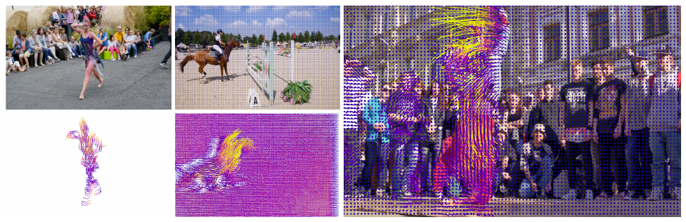
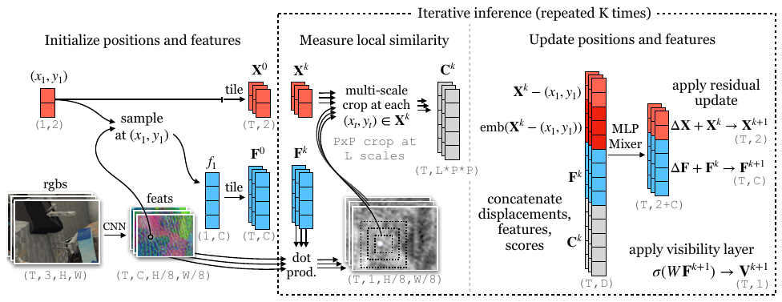
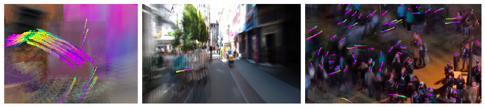
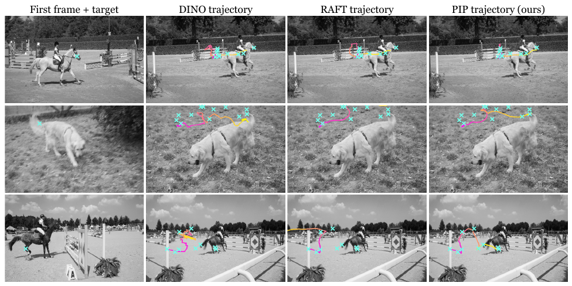

# PIPs — Particle Video Revisited: Tracking Through Occlusions Using Point Trajectories

> 把 2006 年的 "particle video" 老想法用现代组件（dense cost map + 迭代优化 + 可学习外观更新）重造，让**每个像素点独立地**在 8 帧窗口内被跟踪成一条带可见性标签的长程轨迹，从而能穿过遮挡并在目标重新出现时接回——这是 2 帧光流和帧间特征匹配都做不到的。

*原文 Fig. 1：给定首帧若干目标点，模型逐点输出跨帧轨迹；左两栏是"目标 + 单独画的轨迹"，右栏是"轨迹叠加在原像素上"。*

## Metadata

| 项目       | 内容                                                                             |
| -------- | ------------------------------------------------------------------------------ |
| 标题       | Particle Video Revisited: Tracking Through Occlusions Using Point Trajectories |
| 作者       | Adam W. Harley, Zhaoyuan Fang, Katerina Fragkiadaki                            |
| 机构       | Carnegie Mellon University                                                     |
| 发表       | ECCV 2022                                                                      |
| arXiv    | [2204.04153](https://arxiv.org/abs/2204.04153)（v2, 2022-07-25）                 |
| 项目页 / 代码 | https://particle-video-revisited.github.io                                     |
| 方法简称     | **PIPs**（Persistent Independent Particles，"pip" 也是骰子/多米诺上的圆点之意）                |
| 关键词      | 长程点轨迹、遮挡、amodal 对应、particle video、MLP-Mixer                                    |
| 配图       | 裁自原文 Fig. 1–4，统一存放于 `assets/`（命名 `PIPs_fig<编号>_<说明>.png`）                      |

## 1. 问题动机

视频中的运动估计长期被两条路线主导，且各有硬伤：

| 路线                     | 代表       | 缺陷                                                    |
| ---------------------- | -------- | ----------------------------------------------------- |
| 光流（optical flow）       | RAFT     | 只看**相邻两帧**的位移场；目标一旦被遮挡就"不在流场里了"，链式（chaining）累积误差并直接跟丢 |
| 特征匹配（feature matching） | DINO、CRW | 把新帧特征与某一帧（或多帧）匹配，**没有时序上下文**；遮挡帧无匹配可用，且匹配往往很粗         |

作者的观点：真正缺的是**像素级的长程轨迹（long-range trajectories）**，它可以同时带来两样东西：

1. **穿遮挡的持续性（persistence through occlusions）**——世界表面上的点即使短暂不可见也依然存在；
2. **多帧时序上下文（multi-frame temporal context）**——之前的工作（如常数速度先验）只用时间做了很弱的约束，收益有限。

这正是 Sand & Teller (2006) 提出的 "particle video" 想占的中间地带，但此后相关工作很少，本文将其重建。

## 2. 任务定义

- **输入**：$T$ 帧 RGB 视频；首帧上的一个目标坐标 $(x_1, y_1)$。
- **输出**：
  - 轨迹 $\{(x_t, y_t)\}_{t=1}^{T}$（$T \times 2$ 矩阵）；
  - 逐帧可见性 $v_t \in [0,1]$。
- 可并行查询任意数量 $N$ 个粒子（首帧像素网格内任意位置），**部分计算（CNN 特征）在粒子间共享，但轨迹之间完全不交换信息**。
- 输出是 **amodal** 的：目标被遮挡时轨迹继续延伸，不中止，待其复现后再接上。

## 3. 方法

整体结构与 RAFT 类似，分四步（见原文 Fig. 2）：**提特征 → 初始化 → 度量局部外观相似度 → 迭代更新**。

*原文 Fig. 2（架构图，建议对照阅读）：左侧 `sample at (x₁,y₁)` 得到 $f_1$ 后 `tile` 成 $F^0$、坐标 `tile` 成 $X^0$；中间虚线框是重复 $K$ 次的迭代推理；右侧 `apply residual update` 与 `apply visibility layer` 是两个输出头。*

### 3.1 特征提取
每帧**独立**过一个 2D CNN（RAFT 的 `BasicEncoder`：7×7 stride-2 卷积 + 6 个 3×3 残差块 + 1×1 卷积），输出 $1/8$ 分辨率、$C=256$ 维特征图。注意没有时序卷积，时序建模全部放在后面的更新模块里。

### 3.2 每个目标的初始化
- **特征轨迹**：在首帧特征图上按 $(x_1,y_1)$ 双线性采样得到 $f_1$，沿时间**平铺**成 $F^0$（$T \times C$）→ 隐含"外观恒常"先验。
- **位置轨迹**：把 $(x_1,y_1)$ 沿时间复制成 $X^0$（$T \times 2$）→ 隐含"零速度"先验（即对运动不做任何假设）。

上标 $k$ 表示迭代次数。

### 3.3 度量局部外观相似度
把 $F^k$ 中每一帧的特征 $f_t$ 与该帧特征图做相关（correlation），再以当前位置 $(x_t,y_t)$ 为中心**双线性采样一块局部 patch**，得到未归一化的相似度分数块：

- 单帧 patch 尺寸 $P \times P$；
- 与 RAFT 一样做**多尺度空间金字塔**，共 $L$ 层，得到 $C^k$，形状 $T \times P{\cdot}P{\cdot}L$。

### 3.4 迭代更新（核心）
把三类信息在通道维拼接成 $T \times D$ 的序列：

1. 特征 $F^k$；
2. 多尺度相关金字塔 $C^k$；
3. 由 $X^k$ 得到的**位移** $X^k - (x_1, y_1)$，并施加 Transformer 式**正弦位置编码**（用相对位移而非绝对坐标 ⇒ 模型平移不变）。

送入 **12 块 MLP-Mixer**（全 MLP、参数高效、结构上类似 transformer），每帧的输入被展平成一个 token；模型尾部对序列维取均值，再经线性层映射回 $T\cdot(C+2)$ 维。输出是位置增量与特征增量：

$$F^{k+1} = F^k + \Delta F, \qquad X^{k+1} = X^k + \Delta X$$

每次更新后都用**更新过的特征**在新坐标处重算相关金字塔。共迭代 $K$ 次（训练与测试均 $K=6$）。

> 与 RAFT 的两点关键差异：**① PIPs 同时更新特征**（应对外观变化）；**② 相关与更新发生在跨 $T$ 帧的整条轨迹上**，而非一对帧。

### 3.5 可见性估计
最后一次迭代的特征 $F^K$ 过一个线性层 + sigmoid，得到逐帧可见性分数 $V^K$。它既是输出，也是测试时决定"从哪里续接轨迹"的依据。

### 3.6 监督（三个损失）

$$\mathcal{L}_{\text{main}} = \sum_{k}^{K} \gamma^{\,K-k}\,\lVert X^{k} - X^{*} \rVert_1 \quad (\gamma = 0.8)$$

- 对所有迭代步都监督（RAFTS 式指数递增权重），**遮挡与出界时也照常监督**——因为 GT 是合成得来的 amodal 轨迹。这是主损失，光靠它能训但收敛慢且学不会可见性。

$$\mathcal{L}_{\text{ce}} = V^{*}\log V + (1-V^{*})\log(1-V)$$

$$\mathcal{L}_{\text{score}} = -\log\!\Big(\frac{\exp(c_i)}{\sum_j \exp(c_j)}\Big)\cdot \mathbb{1}\{V^{*} \neq 0\}$$

- $\mathcal{L}_{\text{score}}$ 直接把相关分数图推向"真实对应位置处取峰"，$i$ 为真值像素索引，仅在目标可见时生效。作者称它显著加速收敛。

### 3.7 测试时的轨迹链接（超出 $T$ 的时长）
想在长视频上得到任意长的轨迹，就从已估轨迹上的某个时刻 $(x_t,y_t)$ 重新当作 $(x_1,y_1)$ 再跑一遍推理，把轨迹"接长"。关键技巧：

- **不能**总从最后一个时刻续接，否则若该时刻目标被遮挡，模型会转而跟踪遮挡物（identity switch）；
- 因此用**可见性分数**挑一个尽量靠后的高可见时刻：阈值从 **0.99 起，每次降 0.01** 直到找到合法选择；
- 全部重新初始化时**复用最初的 $F^0$**，把身份"锁"在原始目标上。

只要单次遮挡跨度 < $T$，模型就能"跳过"这段遮挡续上轨迹。

## 4. 训练数据：FlyingThings++（本文自建）

基于 FlyingThings（10 帧视频 + 前向/后向 GT 光流 + 实例 mask）：

1. 把光流**正向链式**成多帧轨迹；
2. 丢弃不满足以下条件的链：前向-后向一致性检查失败 / 离开图像边界 / 从一个实例 ID 跳到另一个；
3. 剩下一批稀疏的 **8 帧轨迹，约占首帧 30% 的像素**——但这些轨迹**每一帧都可见**，没有遮挡；
4. 于是**在线合成遮挡**：对每个 batch 中的视频，从另一段 FlyingThings 视频里随机取一个物体，按其 mask **逐帧贴到当前视频上覆盖像素**，同时更新 GT 与轨迹列表（加入遮挡物自身的轨迹）；
5. 数据规模：**13085 训练 / 2542 测试**视频（每段至少含 256 条合法 8 帧轨迹）；
6. 在线增强：随机颜色/亮度、随机尺度、随时间随机平移的裁剪、随机高斯模糊、水平/垂直翻转。

选择 FlyingThings 的理由：视觉与运动极其复杂（有泛化希望），且自带光流与 mask 可挖轨迹。

## 5. 实验

### 5.1 基线与设置
所有实验共用**同一个 PIP 模型**，未针对任何测试域调参。

- **RAFT**（光流 SOTA）：对相邻帧两两算流再链式成轨迹，出界则钳制坐标在边界采样；
- **DINO**（ViT-S/8 自监督特征）：首帧↔当前帧最近邻 + 相邻帧最近邻 + 局部窗口限制（"Windowed"）；
- **CRW**（对比随机游走，循环一致性）、**MAST**（重建式自监督）、**VFS**（帧级相似度）、**ImageNet ResNet50**。

### 5.2 轨迹误差（像素，越低越好）

| 数据集 | 指标分组 | DINO | RAFT | **PIPs** |
|---|---|---|---|---|
| FlyingThings++ (384×512) | 可见 Vis. | 40.68 | 24.32 | **15.54** |
| FlyingThings++ | 遮挡 Occ. | 77.76 | 46.73 | **36.67** |
| KITTI (320×512) | 可见 Vis. | 13.33 | **4.03** | 4.40 |
| KITTI | 遮挡 Occ. | 13.45 | 6.79 | **5.56** |
| CroHD (768×1280) | 可见 Vis. | 22.50 | 7.91 | **5.16** |
| CroHD | 遮挡 Occ. | 26.06 | 13.04 | **7.56** |

- FlyingThings++ 评判约定：一条轨迹**半数以上**时刻可见算 "visible"，否则算 "occluded"；裁剪到 384×512 使大量轨迹飞出画面。
- 现象：RAFT 在可见像素上尚可，但重度遮挡下误差暴涨，且轨迹常**漂到遮挡物上**（因为遮挡期间流场里本就没有目标）；重训 RAFT 也救不回来——链式方法结构上无法处理**多帧遮挡**。
- KITTI 上二者接近：可见时 RAFT 略优，遮挡时 PIPs 略优；DINO 明显落后（特征分辨率低，轨迹只是"粗跟"）。KITTI 的 8 帧轨迹由 LiDAR + 3D 框标注投影得到，遮挡标签用"是否有其他物体从前方穿过"近似。
- CroHD（1080×1920 人群头部）上 PIPs 在两种条件下都**大幅领先**，DINO 在此数据上尤其吃力（目标彼此太像）。

*原文 Fig. 3：背景是视频 RGB 的均值。注意 FlyingThings++（左）的运动极其混乱，但正是这套训练数据让模型能泛化到 KITTI 与人群场景。*

### 5.3 BADJA 关键点传播（PCK-T）

设定：关键点只在首帧给出，需一路传播到视频末尾；判对阈值为 $0.2\sqrt{A}$（$A$ 为该帧真值分割 mask 面积）。采用**更难的设置**：每帧的分割真值不可用。

| 方法 | bear | camel | cows | dog-a | dog | horse-h | horse-l | **Avg.** |
|---|---|---|---|---|---|---|---|---|
| Win. DINO | 77.9 | 69.8 | 83.7 | 17.2 | 46.0 | 29.1 | 50.8 | 53.5 |
| Win. ImageNet ResNet | 70.7 | 65.3 | 71.7 | 6.9 | 27.6 | 20.5 | 49.7 | 44.6 |
| Win. CRW | 63.2 | 75.9 | 77.0 | 6.9 | 32.8 | 20.5 | 22.0 | 42.6 |
| Win. VFS | 63.9 | 74.6 | 76.2 | 6.9 | 35.1 | 27.2 | 40.3 | 46.3 |
| Win. MAST | 35.7 | 39.5 | 42.0 | 10.3 | 8.6 | 12.6 | 14.7 | 23.3 |
| Win. RAFT | 64.6 | 65.6 | 69.5 | 3.4 | 38.5 | 33.8 | 28.8 | 43.5 |
| DINO | 75.0 | 59.2 | 70.6 | 10.3 | 47.1 | 35.1 | 56.0 | 50.5 |
| ImageNet ResNet | 65.4 | 53.4 | 52.4 | 0.0 | 23.0 | 19.2 | 27.2 | 34.4 |
| CRW | 66.1 | 67.2 | 64.7 | 6.9 | 33.9 | 25.8 | 27.2 | 41.7 |
| VFS | 64.3 | 62.7 | 71.9 | 10.3 | 35.6 | 33.8 | 33.5 | 44.6 |
| MAST | 51.8 | 52.0 | 57.5 | 3.4 | 5.7 | 7.3 | 34.0 | 30.2 |
| RAFT | 64.6 | 65.6 | 69.5 | 13.8 | 39.1 | 37.1 | 29.3 | 45.6 |
| **PIPs (ours)** | 76.3 | **81.6** | **83.2** | **34.2** | 44.0 | **57.4** | **59.5** | **62.3** |

- 7 段视频中 **4 段最优**，平均领先第二名 **9 个点**；DINO 在其余视频最好，但最大优势仅 3 个点。
- 作者提醒：DAVIS 有**目标居中偏差**（object-centric bias），而 DINO 的特征含图像位置嵌入（translation-sensitive），能"沾光"；RAFT 与 PIPs 的跟踪更通用。
- 加空间窗口（"Win."）对 DINO 等有帮助但不稳定（视运动类型而定）；PIPs 聚焦的是**无约束**版本，即从第 1 帧一路传到任意帧。

*原文 Fig. 4：第 1 行目标（狗尾巴上的点）出画后回到视野；第 2 行目标（马腿）被短暂遮挡 —— **RAFT 直接彻底跟丢，DINO 只是粗略跟着，PIPs 始终贴在目标上**。这是全文最有说服力的一张对比图。*

### 5.4 效率与复杂度

- 目标数少到能放进 GPU 时（如 12G 显存放 256 个目标），480×1024 下 **PIPs ≈ 200ms，RAFT ≈ 2000ms**。RAFT 慢的原因：显存吃不下全帧并行流场，必须跑 $T-1$ 次；且它要算**所有**像素的流，而 PIPs 只算被查询的目标。
- 目标数过多时按 batch 分批，此时 PIPs 可能反而比 RAFT 慢。
- 内存主要随 $T \cdot N$ 增长（$N$ 为粒子数），因为 MLP-Mixer 要为每个粒子消费一条 $T$ 长序列。

## 6. 实现细节速查

| 超参 / 组件 | 取值 |
|---|---|
| CNN | RAFT `BasicEncoder`，输出通道 $C=256$，特征 stride 8 |
| 相关金字塔 | 4 层，半径 3 ⇒ 每帧 4 个 7×7 patch |
| 更新网络 | 12 块 MLP-Mixer（序列维末尾取均值 + 线性层 → $T(C+2)$） |
| 时间窗 $T$ | 8（同时考虑 8 帧；$T=32$ 更难训，怀疑因无跨时间权重共享、轨迹组合复杂度增长快） |
| 迭代数 $K$ | 6（>6 无增益） |
| 训练分辨率 | 368×512；每个样本随机采 **128 条**首帧在界内且未遮挡的轨迹 |
| 优化 | AdamW，lr 3e-4，1-cycle 调度，batch 4（4 卡），100k steps；**4×RTX 2080 约 2 天** |
| 测试 stride | 4（比训练的 8 更好，测试数据分辨率高） |
| 推理批大小 | 单卡可容纳的目标数量（示例：12G 显存 / 256 目标） |

## 7. 局限（作者自述）

1. **空间感知换时序感知的极端取舍**：每个粒子完全独立，**丢弃了轨迹之间可共享的信息**（空间平滑性）。作者自己也对"单粒子跟踪竟然这么好"感到意外，并指出**同时估计多条轨迹**是直接的未来方向。
2. **MLP-Mixer 导致模型在时间上不循环**：超过时间窗 $T$ 的持续遮挡会彻底丢失目标。作者试过时间维卷积与序列自注意力，但在 FlyingThings++ 上都不如 MLP-Mixer。更长的、可变长度的时序上下文是未解问题。

## 8. 阅读总结

- **最核心的可迁移思想**：把时序先验做得足够强，就允许模型在**多个中间帧上对应失败**；只要在稀疏的若干时刻"找到"目标，就能靠先验为其余时刻**内插**出合理位置。这解释了为什么它能穿遮挡、也比匹配方法更平滑。
- **数据侧的小技巧很实用**：从已有光流数据"挖"稀疏但精确的多帧轨迹（用一致性/出界/实例 ID 三重过滤保证质量），再**在线合成遮挡**补上缺失的困难样本。这套流程不依赖新标注。
- **身份锁（reuse $F^0$）** 是个便宜又好用的 trick，避免续接时跟踪到遮挡物；可见性分数驱动的续接时刻选择同样简单有效。
- **对本工作目录（PoseTrackingData）的潜在关联**：PIPs 提供的是"像素级对应 + 可见性"，天然适合做**关键点/姿态标注的跨帧传播**（BADJA 实验即是证明），也可作为伪标签生成器、或与姿态估计器联合用于遮挡鲁棒性提升。它的可见性输出还能充当"该帧关键点是否可信"的置信度。
- **明确不适用**：需要极长时序（数十帧以上持续遮挡）、或高度依赖多目标/多关节间空间一致性（如整条骨架的耦合约束）的场景——这两点恰是 PIPs 的取舍代价，后续工作（见下）主要就在补这两块。
- *（个人补充，超出原文，未在原文中验证；[[TAP-Vid]] 与 [[TAPIR]] 已单独整理成笔记）*：本论文的两个直接后继是 **[[TAP-Vid]]**（Doersch et al., NeurIPS 2022，给出 AJ / $\delta^x_{\text{avg}}$ / OA 这套点跟踪指标与基准）与 **[[TAPIR]]**（ICCV 2023）——后者正是把 PIPs 的 MLP-Mixer 精修换成时间维全卷积、并接上 TAP-Net 的逐帧初始化：速度从 34.5s 提升到 0.3s（50 点 / 256×256），DAVIS AJ 从 42.0 升到 61.3。更晚的 **CoTracker** 用 transformer 让多条轨迹互相通信，正好回应 PIPs"粒子间不通信"的局限。

> **光流看两帧、匹配看两帧对一帧，PIPs 让每个点各自带着一条"8 帧的记忆"反复迭代找自己**——所以它能活着穿过遮挡，在目标重新出现时接回轨迹。
