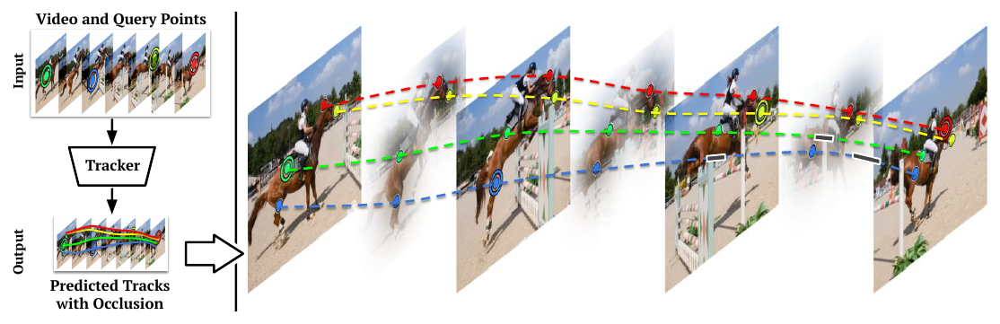
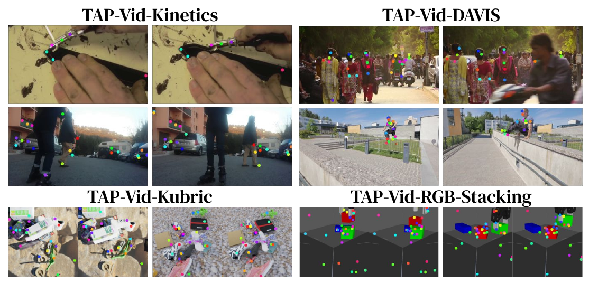
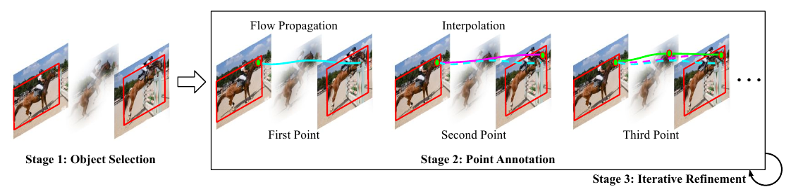
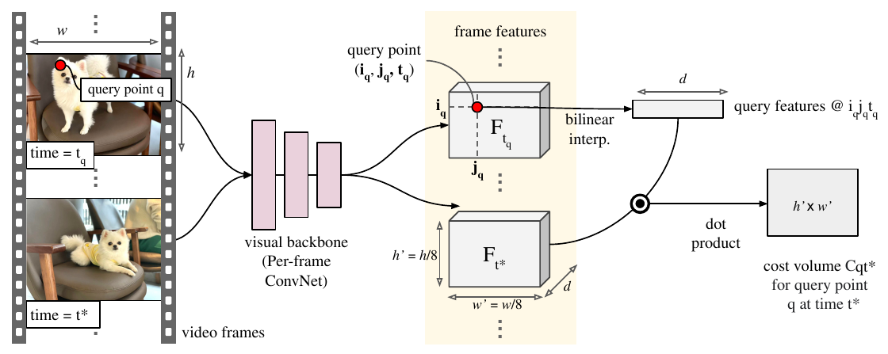
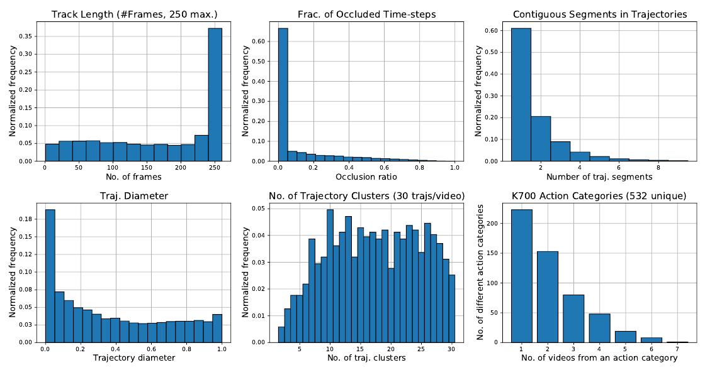

# TAP-Vid — TAP-Vid: A Benchmark for Tracking Any Point in a Video

> 把"长时程逐点跟踪"正式定义成一个任务（Tracking Any Point, TAP），并第一次给出配套基准：1,219 段真实视频（Kinetics-700 val + DAVIS val）+ 合成视频，共 31,951 条点轨迹。核心贡献其实是三件事而不是一个模型——**半自动众包标注流程**（用 RAFT 光流做 track assist，把标注成本压到 3.3 小时/10 秒视频）、**同时考核位置与遮挡的指标族**（AJ / <δ^avg / OA），以及一个基于 cost volume 的简单端到端 baseline **TAP-Net**（只用合成数据 Kubric 训练，就能压过 RAFT、COTR、Kubric-VFS-Like 等改造版 baseline，并与同期工作 PIPs 互有胜负）。

*原文 Fig. 1：左边是输入（视频 + 若干带双圈的目标点）与输出（带遮挡标记的预测轨迹），中间的黑盒是 Tracker；右侧把多条轨迹叠在马术视频的若干帧上。**看色标**：彩色线是轨迹，其中**黑色实线段表示该帧点不可见（被遮挡）**，彩色（虚线）段表示可见。注意 query point 是 $(x, y, t)$ 三元组，不限于第一帧，一条轨迹上可以有多个 query。*

## Metadata

| 项目 | 内容 |
|---|---|
| 标题 | TAP-Vid: A Benchmark for Tracking Any Point in a Video |
| 作者 | Carl Doersch\*, Ankush Gupta\*, Larisa Markeeva\*, Adrià Recasens\*, Lucas Smaira\*, Yusuf Aytar\*, João Carreira\*, Andrew Zisserman\*†, Yi Yang\* |
| 机构 | \*DeepMind；†VGG, Department of Engineering Science, University of Oxford |
| 发表 | NeurIPS 2022（Datasets and Benchmarks Track） |
| arXiv | [2211.03726](https://arxiv.org/abs/2211.03726)（v2, 2023-03-31） |
| 项目页 / 代码 | https://github.com/deepmind/tapnet |
| 方法简称 | **TAP-Vid**（数据集/基准）、**TAP**（Tracking Any Point，任务名）、**TAP-Net**（本文提出的 baseline） |
| 关键词 | point tracking、benchmark、occlusion、human annotation、cost volume、long-term correspondence |
| 阅读日期 | 2026-10-08 |
| 配图 | 裁自原文 Fig. 1、3、4、6、7，存放于 `assets/`（命名 `TAP-Vid_fig<编号>_<说明>.png`） |

## 1. 问题动机

视频运动估计的现有路线各自只覆盖问题的一部分，且都有硬伤（原文 Fig. 2 把五条路线并排画出来，原文 Table 1 把数据集逐项对比）：

| 路线 | 代表 | 缺陷 |
|---|---|---|
| bounding box / segment tracking | GOT-10k、TAO、YouTube-BB、DAVIS | 只输出框或掩码，**丢失表面旋转与形变信息** |
| optical flow | RAFT、FlowNet | 面向**帧对**，天生不做长时程，遮挡估计能力有限，链式累积误差且无法纠错 |
| Structure-from-Motion 关键点匹配 | SuperPoint、COTR、MegaDepth 系列 | 稀疏兴趣点、假定刚性场景、**把遮挡交给几何一致性过滤**，不适合可变形与弱纹理物体 |
| semantic keypoint tracking | JHMDB、PoseTrack、300VW、COCO-WholeBody | 关键点由**人工按类别指定**（人脸/人体/手），无法扩展到任意物体与任意表面 |
| **physical point tracking（本文）** | TAP-Vid / TAP-Net | 目标：物理表面上**任意**点、跨整段视频、带遮挡标记 |

作者要补的正是中间这块空缺：**任意物理表面上任意点的长时程跟踪**。动因有三条：

1. 这类信息对推断 3D 形状、物理属性、物体交互都有用；对具身智能（机器人）尤其关键，因为很多任务需要精确的时序空间控制。
2. 人类能凭 "common fate" 这一格式塔原则**直接判断点跟踪是否正确**，所以人工标注在原理上可行——只是极其耗时（物体与相机都在做复杂的非线性运动）。
3. 此前**根本不存在**评测该任务的数据集与 benchmark。最接近的是 JHMDB（只做 15 个人体关节）：它在 §7.1 被批评为任务本身 ill-posed——关节在物体内部、深度未知，而且标注者在关节被遮挡时也照样标位置，用它的方法通常还得 ad-hoc 地"先把点转成 segment 再跟踪"。原文在 related work 里还提到同期工作 PIPs 找不到好的评测数据，主要依赖 BADJA，而 BADJA "contains just 9 videos"，且跟的是关节而非表面点。

原文 Table 1 的数据集对比（✓ = 具备，✗ = 不具备）：

| Dataset | Type | #Videos (#Images) | Duration / Time-scale | Long-term? | Point Precise? | Class Agnostic? | Non-rigid? |
|---|---|---|---|---|---|---|---|
| KITTI | Optical flow | 156 | 400 frame pairs | ✗ | ✓ | ✓ | ✓ |
| COCO-DensePose | Surface Points | (50k) | — | ✗ | ✓ | ✗ | ✓ |
| COCO-WholeBody | Semantic Keypoints | (200k) | — | ✗ | ✓ | ✗ | ✓ |
| DAVIS | Masks (multi-object) | 150 | 25 fps @ 2-5s | ✓ | ✗ | ✓ | ✓ |
| GOT-10k | BBs (single-object) | 10k | 10 fps @ 15s | ✓ | ✗ | ✓ | ✓ |
| TAO | BBs (multi-object) | 3k | 1 fps @ 37s | ✓ | ✗ | ✓ | ✓ |
| YouTube-BB | BBs (single-object) | 240k | 1 fps @ 20s | ✓ | ✗ | ✗ | ✓ |
| PoseTrack | Semantic Keypoints | 550 (37k) | train: 30 fps @ 1s；eval: 7 fps @ 3–5s | ✓ | ✓ | ✗ | ✓ |
| 300VW | Facial Keypoints | 300 | 30 fps @ 1–2 mins | ✓ | ✓ | ✗ | ✓ |
| ScanNet | SfM 3D recons. | 1500 | ∼1 min | ✓ | ✓ | ✓ | ✗ |
| MegaDepth | SfM 3D recons. | 200 scenes (130k) | — | ✓ | ✓ | ✓ | ✗ |
| **TAP-Vid-Kinetics** | Arbitrary points | **1,189** | **25 fps @ 10s** | ✓ | ✓ | ✓ | ✓ |

原文的三点贡献（直接照抄）：

1. 设计并验证一套**辅助标注算法**，让标注者能更准确地跟踪点（flow-based track assist）；
2. 构建评测数据集：**31,951（31,301+650）条点轨迹，跨 1,219（1,189+30）段真实视频**；
3. 探索若干 baseline，并把该数据集与最接近的 JHMDB 对比，证明**用 TAP 的形式训练能提升 JHMDB 上的性能，反过来不行**。

## 2. 任务定义

- **输入**：一段视频 + 一组 query points $(x, y, t)$。$x, y$ 是 2D 像素位置，$t$ 是帧号；query 不限于第一帧，同一段视频上可以有任意多个 query（Kinetics 每段的轨迹数量，§5.1 说 "≈ 30 trajectories/video"，而 Table 2 给的均值是 26.3 个点，两处略有出入）。
- **输出**（每个 query 各一份）：
  - 每帧一个位置 $(x_t, y_t)$；
  - 每帧一个二值遮挡标记 $o_t$。
- **遮挡期间 $(x_t, y_t)$ 的输出被约定为无意义**（"typically assumed to be meaningless"），所以位置类指标只在 GT 可见的帧上计算。
- **唯一的前置约束**：目标点所在的表面必须能从**单个像素 query** 无歧义确定。因此明确不处理透明物体、液体、气体。
- 与相近任务的区别：可以看成"把 optical flow 扩展到更长的时间跨度 + 加上遮挡估计"，也可以看成"把 SfM 式的关键点匹配从刚性场景扩展到真实视频（含可变形、弱纹理物体），并加上遮挡估计"。
- 评测约定：四个数据集**统一缩放到 256×256** 评测；query 默认按 **stride 5** 采样（从第 0 帧起，每 5 帧对每个可见点取一次 query），因此同一条轨迹会被多次查询；Kinetics/DAVIS/RGB-Stacking 也提供"只用该点首个可见帧作 query、只向未来跟踪"的 online 友好设置。

## 3. 方法

这是 benchmark 论文，所以"方法"= 数据集构造 + 标注工具 + 指标定义 + baseline 模型。

### 3.1 四个 split 的数据构成

| Split | 视频数 | 平均点数 | 帧数 | 原始分辨率 | 真实/合成 | 评测分辨率 |
|---|---|---|---|---|---|---|
| TAP-Vid-Kinetics | 1,189 | 26.3 | 250 | ≥720p | Real | 256×256 |
| TAP-Vid-DAVIS | 30 | 21.7 | 34–104 | 1080p | Real | 256×256 |
| TAP-Vid-Kubric | 38,325 / 799（train / test） | flexible | 24 | 256×256 | Sim | 256×256 |
| TAP-Vid-RGB-Stacking | 50 | 30 | 250 | 256×256 | Sim | 256×256 |

*原文 Fig. 3：上排是真实视频（Kinetics 的涂漆/街景、DAVIS 的人群与运动），下排是合成视频（Kubric 的物理堆叠场景、RGB-Stacking 的机器人堆叠）。**要看的重点**：真实数据集里的点大量落在非显著物体上（不是人体关节），合成数据的点可以密集地铺在无纹理表面上——这正是 TAP 与"语义关键点跟踪"的分界线。*

- **TAP-Vid-Kinetics**：取自 Kinetics-700 validation，只随机挑有 720p 可用的片段（利于标注精度）。非结构化 YouTube 片段：多运动物体、镜头运动/抖动、光照不理想。Kinetics 片段 10 秒，按 25 fps 重采样成 **250 帧**。
- **TAP-Vid-DAVIS**：取自 DAVIS 2017 validation 的 30 段（专为 segment tracking 设计的难例）。因 DAVIS 常只有一个显著物体，标注规则改为**最多 5 个物体、每物体最多 5 个点**；点轨迹在 **1080p** 下标注以提高精度；整集用于评测。
- **TAP-Vid-Kubric**：合成 MOVi-E（Kubric 提出）：每段视频约 20 个物体被丢进场景，Bullet 物理 + Blender 光线追踪。**既作主训练集也作评测**，同分布的 799 段作为验证/测试集。
- **TAP-Vid-RGB-Stacking**：模拟机器人堆叠环境，录了 50 个 episode（遥操作者摆弄几何体，被要求做出多样有趣的运动）；用 triplet-4 物体集与 front-left 相机。每段从首帧采 30 个点（20 个在运动物体上、10 个在静态物体/背景上）并用模拟器跟踪。**特别难**：物体无纹理、旋转对称，且机械爪遮挡频繁。
- **定位**：真实数据"principally aim for an evaluation benchmark"，作者建议**只用 Kubric 训练**，把另外三个数据集留作测试；标注以 CC-BY 4.0 协议发布。若要做大量实验，建议用 TAP-Vid-DAVIS 做验证集、其余严格留作测试，且不鼓励在留出集上做自动化架构搜索。

### 3.2 真实视频标注流程（三阶段半自动流水线）

*原文 Fig. 4：Stage 1 用框选物体；Stage 2 里标注者只给稀疏点（First/Second/Third Point），中间帧由 track assist 用光流传播 + 插值补全；Stage 3 是迭代精修（右下角的回转箭头）。这张图是理解"为什么 3.3 小时能标完 250 帧 × 30 条轨迹"的关键。*

由 **15 名** Google 众包池的标注者完成，按小时付酬；设计（含报酬标准）经 DeepMind 独立伦理审查委员会审核，所有标注者均知情同意。

- **Stage 1（物体选择）**：标注者选最多 $K$ 个物体（Kinetics $K=10$，DAVIS $K=5$），优先显著、出现时间长、有运动、会发声的物体；物体定义是"独立存在的实体"（车、椅子、人），排除液体/气体/透明物。每 30 帧画一次框（用 Kuznetsova et al. 的界面，但**不使用任何自动框跟踪**），并给每个物体加一个文本标签。
- **Stage 2（点标注）**：对每个物体选 $M$ 个点（Kinetics $M=3$，DAVIS $M=5$），然后**要求标注者隔帧标注**对应位置（被遮挡的帧显式标为不可见）。隔帧标注更准，因为人眼是靠"点怎么动"来判断它是否附着在表面上的；但逐帧全标不可行，所以由 **track assist** 算法把稀疏人工点补成稠密轨迹。标注者可自由增减点以达到目标精度。交互上每条轨迹以 ENTER 点开始、MOVE 点延续、EXIT 点结束；**遮挡后可用新的 ENTER 点重新起一条同 tag 的轨迹**；光标是十字形以便精确定位。
- **Stage 3（迭代精修）**：初次提交后，每个标注点的轨迹交给**另一位标注者**检查与修正，如此迭代直到最后一位标注者认同此前所有标注。一段 10 秒视频平均约 **3.3 小时**完成，通常有 **4–5 名标注者**参与精修。

**Track assist 算法**（原文式 1）：先用 RAFT 算出整段视频的光流；当标注者给出起点 $p_s$（第 $s$ 帧）与第二个点 $p_t$（第 $t$ 帧）后，在所有从 $s$ 到 $t$ 的路径 $\rho$ 中求

$$\arg\min_{\rho \in P_{s:t}} \sum_{i=s}^{t-1} \lVert (\rho_{i+1} - \rho_i) - F(p_i) \rVert^2 \quad \text{s.t.} \quad \rho_s = p_s,\ \rho_t = p_t$$

即"路径的逐帧位移与光流估计的偏差平方和最小"。这是非凸问题，但可看作图上的最短路径问题（每个像素是一个节点，第 $i$ 帧的每个像素与第 $i+1$ 帧的每个像素相连，边权为与光流偏差的平方），用 Dijkstra 类算法可在几秒内求解——**比标注者点两次还快**，即使两点相隔几十帧。若两个人工点相距 **< 5 帧**，则假定光流估计无益、干脆线性插值；标注者也可随时回退到线性插值。

这套设计的质量证据：平均每条 track-segment（连续、无遮挡的子轨迹）需要**人工点击 10.2 次**，而平均每段长 **57 个点（帧）**，最少 2 个人工点（起止）。作者认为这说明标注者在主动消除自动传播带来的漂移误差。

### 3.3 评测指标（本文最核心的设计）

遮挡是二值判断、位置是回归，两者无法直接比较。因此作者像 PCK 那样**先把回归问题按阈值二值化**，再沿用目标框跟踪（HOTA）提倡的 **Jaccard 形式**，把位置与遮挡合成一个数。三个指标定义如下：

**1. OA（Occlusion Accuracy）**：逐帧遮挡预测的简单分类准确率，取值 $[0,1]$，越高越好。只看遮挡、不看位置。

**2. <δ^avg（Average Accuracy，位置精度；原文记作 $<\delta^{x}_{\text{avg}}$）**：只在 **GT 可见**的帧上计算。对给定阈值 $\delta$，统计预测位置与 GT 距离小于 $\delta$ 的点占比（与 PCK 同构）。关键区别：**PCK 通常把阈值相对人体尺度归一化，这里不做——图像统一缩放到 256×256 后直接以像素计**。<δ^avg 在 **5 个阈值 δ ∈ {1, 2, 4, 8, 16} 像素**上取平均。只看位置、不看遮挡。

**3. AJ（Average Jaccard）**：同时考核遮挡与位置。对给定阈值 $\delta$，

$$\text{Jaccard}_\delta = \frac{TP}{TP + FP + FN}$$

- $TP$（true positives）：预测可见、且与 GT 可见点的距离在阈值内的点；
- $FP$（false positives）：**预测可见，但 GT 是遮挡**，或预测距离超过阈值的点；
- $FN$（false negatives）：**GT 可见，但预测为遮挡**，或预测距离超过阈值的点。

AJ 在**同样的 5 个阈值 {1, 2, 4, 8, 16} 像素**上取平均，取值 $[0,1]$。

为什么这样设计：单看 <δ^avg 会奖励"永远预测可见"（遮挡帧被忽略），单看 OA 会奖励"位置乱猜但遮挡猜对"，而 AJ 的 Jaccard 分母同时含 FP 与 FN，**逼着方法既要在可见时找对位置，又要在不该看见时承认看不见**；三个指标合起来还能做诊断（AJ 低而 <δ^avg 高 ⇒ 遮挡估计是瓶颈，反之亦然）。阈值取 1/2/4/8/16 这组等比像素值并在其上平均，等价于对"从严格到宽松的精度要求"做一次积分，比单阈值稳健。

> 原文未明确：AJ 定义里"points within the threshold of **any** visible ground truth points"的措辞，暗示多条轨迹落在同一帧时会做某种匹配，但正文没有展开实现细节。阈值对应关系可以确认：正文写 <δ^avg 在 "5 thresholds: 1,2,4,8, and 16 pixels" 上取平均，附录 F.1 又直接写出 "<$\delta_1$ (**2 pixels** away)" 与 "<$\delta_0$ (**1 pixel** away)"，两处文字互相钉住了 $\delta_0$=1px、$\delta_1$=2px，故 $\delta_0 \dots \delta_4$ = **1, 2, 4, 8, 16 像素**（原文没有单独给对照表，但对齐关系无歧义）。

### 3.4 baseline 模型 TAP-Net（cost volume）

*原文 Fig. 7：整条视频帧过一个 **per-frame** 视觉 backbone 得到 $h' \times w' \times d$ 的特征图；query 点 $(i_q, j_q, t_q)$ 处的特征由双线性插值得到 $F_q$（$d$ 维）；再与另一时刻 $t^*$ 的空间特征做**点积**（dot product），得到该 query 在该时刻的 cost volume $C_{qt^*}$（$h' \times w'$）。注意 backbone 是逐帧的——时序信息只靠 time shifting 引入。*

- **特征提取**：**TSM-ResNet-18**，且**只在最前两层做 time shifting**。作者说明：单帧特征图、以及时间感受野更大的特征图，效果都更差。每个输出具有 **9 帧**的时间感受野，最终输出 256 通道。
- **Cost volume**：$C_{qijt} = F_q^\top F_{ijt}$，即 query 特征与全片所有位置特征的点积，过 ReLU。这是一个 3D 张量。作者强调 cost volume 能检测重复纹理，即使这些纹理训练时没见过。
- **逐帧后处理（原文 Fig. 8）**：先一个 Conv+ReLU，然后分两支。
  - **遮挡支**：Conv（32 单元）→ 空间平均池化 → Linear（16）→ ReLU → Linear（输出 1 个 logit）。先池化再回归，把"哪里"的信息压掉，只留"看不看得见"。
  - **位置支**：Conv（1 个输出通道）→ 空间 softmax → **soft argmax**：先取 heatmap 的 argmax $(\hat i_{qt}, \hat j_{qt})$，再在以它为中心、半径 $\tau$ 的欧氏球 $B$ 内对网格坐标做加权平均：

    $$p_{qt} = \frac{\sum_{ij} \mathbb{1}\{\lVert(\hat i_{qt},\hat j_{qt}) - (i,j)\rVert_2 < \tau\} S_{qijt} G_{ij}}{\sum_{ij} \mathbb{1}\{\lVert(\hat i_{qt},\hat j_{qt}) - (i,j)\rVert_2 < \tau\} S_{qijt}}$$

    其中 $\tau = 5$ 个网格单元。作者承认阈值化和 argmax 不可微，但梯度仍指向正确方向（误差会让 softmax 的整体质量向 GT 移动）。
- **损失**（原文式 3）：

  $$\mathcal{L}(\hat p, \hat o, p^{gt}, o^{gt}) = \sum_t (1 - o^{gt}_t) L_H(\hat p_t, p^{gt}_t) - \lambda\big[\log(\hat o)o^{gt} + \log(1-\hat o)(1-o^{gt})\big]$$

  位置用 Huber 损失、**仅在 GT 可见的帧上回归**（因此位置被当作简单回归问题）；遮挡用标准交叉熵。Huber 是为了不被偶发大误差主导。

## 4. 训练数据 & 实验设置

### 4.1 合成训练数据与 GT 轨迹生成（附录 D）

Kubric 与 RGB-Stacking 都只含**刚体**，因此 GT 点轨迹按下面的流程从模拟器里"挖"出来：

1. 先在**像素空间**选 query 点（保证 query 可见）；
2. 借坐标图（Kubric 物体自带）或"深度图反投影 + 逆物体变换"求出该点在**物体局部坐标系**中的位置；
3. 用每帧已知的物体变换算出该点的**世界坐标**；
4. 再投影回图像平面得到逐帧位置；
5. **遮挡判定**：把该点算出的深度与模拟器渲染的深度图比较——若该点比深度图（重投影点最近 4 个像素的最大深度）**深 1% 以上**，判为遮挡。

采样规模：Kubric 每段视频**恰好采 256 个 query**，并尽量让每个物体（含背景）分到相同数量的点；为免小物体上点太多，限制每个物体的采样不超过其**像素数的 0.16%**，做法是按像素数升序迭代分配 $N = \lfloor \min(P \times 0.0016,\ 256/K) \rfloor$（$K$ 为剩余物体数，$P$ 为最小物体像素数）。RGB-Stacking 先在首帧**均匀采 600 个 query** 跟踪全片，再挑出 30 个（20 个来自运动物体、10 个来自静态物体/背景）。

训练增强：裁剪（宽高比最高 2:1、最少只保留 30% 的像素）等，作者称"follow prior augmentation algorithms"（跟随 Kubric 的既有增强流程）。

### 4.2 训练/测试划分与训练设置

- 作者用 **Kubric（MOVi-E）训练**，把 **Kinetics / DAVIS / RGB-Stacking 三个 split 完全留作测试**；Kubric 自身另有 799 段验证集。因此三个真实/下游 split 之间的差别不只是域，还有**帧数与标注方式**：Kinetics 是 250 帧的稠密 YouTube 片段（人工标、点最多）、DAVIS 是 34–104 帧的 1080p 短片且每物体只 5 个点（人工标、最偏 object-centric）、RGB-Stacking 是 250 帧的纯合成机器人场景（无纹理 + 频繁遮挡）。
- 训练：**64 个 TPU-v3**，每核 batch 4 段 24 帧 MOVi-E 视频，训练 **50,000 步**；Adam（$\beta_1 = .9, \beta_2 = .95$）+ weight decay $10^{-2}$（即 AdamW）；cosine 调度、峰值学习率 $2\times10^{-3}$、**5,000 步 warmup**；backbone 用 cross-replica BatchNorm，**cost volume 及其之后完全不用 BN**。
- 每个实验约 **24 小时**；最终模型花了约 **25 次全规模实验**（主要靠观察 DAVIS 上的迁移性能来调学习率、模型大小与优化器参数）。
- 微调（JHMDB 实验）：无数据增强、统一缩放到 256×256；每段视频随机采 **128 条** query（同一条轨迹可能被不同 query 采到多次）；1 段视频/TPU core；只训 **5,000 步**（100 步 warmup + cosine），学习率小得多（$10^{-5}$），否则网络会严重过拟合。

### 4.3 标注质量验证（附录 F；这是本文方法论上很值得学的一步）

**A. 用合成 GT 校验人工标注（附录 F.1）**：让标注者去标 10 段来自 Kubric 的视频（有已知 GT），为了更像真实标注场景还额外**注入相机抖动**（MOVi-E 本身没有）并把帧率从 12 fps 提到 25 fps。标注在 1024×1024 分辨率下进行，评测仍统一到 256×256。

| 方法 | AJ | <δ^avg | OA | Jaccard δ₀ | δ₁ | δ₂ | δ₃ | δ₄ | <δ₀ | <δ₁ | <δ₂ | <δ₃ | <δ₄ |
|---|---|---|---|---|---|---|---|---|---|---|---|---|---|
| No OF（无光流辅助） | 74.7 | 83.1 | 97.4 | 25.8 | 64.2 | 90.5 | 96.2 | 96.9 | 41.2 | 78.8 | 96.3 | 99.5 | 100.0 |
| With OF（有光流辅助） | **81.4** | **90.0** | 96.9 | **49.5** | **76.1** | 90.0 | 95.2 | 96.0 | **66.6** | **87.5** | 96.2 | 99.5 | 100.0 |

（原文 Table 5；δ₀…δ₄ = 1, 2, 4, 8, 16 像素。）正文 §5.2 用更直观的说法：有光流辅助时 **>99% 的标注点误差在 8 像素内、96% 在 4 像素内、87% 在 2 像素内**；标注时间从 **50 分钟/视频降到 36 分钟/视频（提速 28%）**，而这还只是 2 秒长的视频。光流辅助对高精度指标的提升尤其明显（按原文说法：$\delta_1$ 的误差率"几乎减半"，$\delta_0$ 的准确率绝对提升超过 25 个百分点）。

> 原文此处自相矛盾：正文 §5.2 说 Kubric 验证视频是 "2 seconds (50 frames at 25 FPS)"，附录 F.1 却说 "2-seconds (24-frame)"。按 F.1 里"把帧率从 12 fps 提到 25"的说法，$2\ \text{s} \times 25\ \text{fps} = 50$ 帧更自洽，括号里的 24 帧疑似旧稿残留。

**B. 用人工一致性兜底（附录 F.2）**：在 DAVIS 上，第一轮标完后，请**不同的标注者**从相同的首帧点出发重标一遍（共 650 个点 / 30 段视频），再用同一套指标比较两份人工答案：

| OA | <δ₀ | <δ₁ | <δ₂ | <δ₃ | <δ₄ |
|---|---|---|---|---|---|
| 95.5 | 51.8 | 78.3 | 92.5 | 98.7 | 100.0 |

（原文 Table 6，256×256 下评测。）即：人类之间在遮挡上一致率 **95.5%**，在 4 像素阈值下的位置一致率 **92.5%**，两条独立人工轨迹平均只差 **1.46 像素**。这个数字同时也给出了该基准的"人类上限"参考。

### 4.4 数据集统计（原文 Fig. 6）

*原文 Fig. 6：六个直方图从左上到右下依次是——轨迹长度（多数占满 250 帧）、被遮挡时间步占比（**0 处有巨大尖峰**，说明多数轨迹全程可见）、轨迹被切成的连续段数、trajectory diameter、每段视频约 30 条轨迹聚成的簇数、以及覆盖的 K700 动作类别数。**要看的是**"长时长 + 高可见 + 大位移 + 多样运动"这四点同时成立的分布形态。*

- 多数轨迹跨满整段视频（250 帧）；**55% 完全不被遮挡**；因遮挡被切成的段数 **>70% 的轨迹 ≤ 2 段**。
- **Trajectory diameter**（一条轨迹上所有位置之间的最大距离）：运动量很大，直径分布近似均匀地覆盖到**图像尺寸的 55%**。
- **运动多样性**用轨迹聚类衡量：对每段视频内约 30 条轨迹做凝聚聚类（agglomerative），轨迹间距定义为"去均值（mean-centered）后逐帧欧氏距离的平均值"（重叠帧 < 10 则视为无穷远），簇间距取两个簇中任意两条轨迹距离的最小值，递归合并直到所有簇间距 ≥ **2 像素**。结果 **≥85% 的视频有 ≥5 个簇**，说明同一视频内的点运动足够多样。
- 覆盖 Kinetics-700 的 **532 个**不同动作类别。
- 语义分布（附录 J）：人工文本标签统计后，**26.1% 的点在人身上、23.4% 在衣物上（穿在身上或不在都算）、50.4% 在其它类型物体上**；符合"优先标运动/前景物体"的标注指令，也说明数据集对"与人交互的智能体"场景是有相关性的。

## 5. 实验

### 5.1 Baselines（附录 I）

能直接套用到本任务的现有方法很少，作者都是"改造"过来的，且刻意保持实现简单：

| Baseline | 做法 | 已知短板 |
|---|---|---|
| **Kubric-VFS-Like** | 唯一能直接套用的算法（Kubric 自带）：对比学习特征，测试时 query 特征与所有帧特征点积 → 空间 soft argmax；遮挡用 **cycle consistency**（从目标帧反查回 query 帧，看是否回到原点）估计 | 非端到端，轨迹不精确；cycle consistency 在真实数据上不灵 |
| **RAFT** | 光流 SOTA 扩展成多帧：对 query 点用**双线性插值**更新位置、逐帧推进；出界时用最近像素的流值，**出界即判遮挡** | 无法处理遮挡；无纠错机制，误差逐帧累积 |
| **COTR** | 图像对匹配（transformer 全局对齐 + 局部精修），把 query 帧与**其它每一帧**配对直接找对应；遮挡借用 cycle consistency（回查距离 > 48 像素判遮挡） | 无内置遮挡机制；训练于刚性场景，对运动物体吃力；RGB-Stacking 上因无纹理直接退化。运行极贵（每对 1 秒/30 点），因此**只在单帧上取 query**，数字只是近似 |
| **PIPs**（同期工作） | 按 "chaining" 工作流：以 8 帧为一段，逐段估计，用前一段的末点初始化下一段；每段内用 MLP-Mixer 迭代精修；一个 query 前后各跑一次；用其自带 visibility（阈值 0.5）判遮挡 | 250 帧 @256×256 需要 **>30 分钟**，因此**只在 167 段随机 Kinetics 视频**上跑（但用了每段视频的全部点）；1×V100 上约 100 小时 |

### 5.2 主结果（原文 Table 3）

原文 Table 3 把四个数据集并排放在一张表里（每个数据集下是 AJ / <δ^avg / OA 三列），这里按数据集拆成两张以便阅读，数字逐字照抄：

| 方法 | Kinetics AJ | Kinetics <δ^avg | Kinetics OA | Kubric AJ | Kubric <δ^avg | Kubric OA |
|---|---|---|---|---|---|---|
| COTR | 19.0\* | 38.8\* | 57.4\* | 40.1 | 60.7 | 78.5 |
| Kubric-VFS-Like | 40.5 | 59.0 | 80.0 | 51.9 | 69.8 | 84.6 |
| RAFT | 34.5 | 52.5 | 79.7 | 41.2 | 58.2 | 86.4 |
| PIPs | 35.1 | 54.8 | 77.1 | 59.1 | 74.8 | 88.6 |
| **TAP-Net** | **46.6** | **60.9** | **85.0** | **65.4** | **77.7** | **93.0** |

| 方法 | DAVIS AJ | DAVIS <δ^avg | DAVIS OA | RGB-Stacking AJ | RGB-Stacking <δ^avg | RGB-Stacking OA |
|---|---|---|---|---|---|---|
| COTR | 35.4 | 51.3 | 80.2 | 6.8 | 13.5 | 79.1 |
| Kubric-VFS-Like | 33.1 | 48.5 | 79.4 | 57.9 | 72.6 | 91.9 |
| RAFT | 30.0 | 46.3 | 79.6 | 44.0 | 58.6 | 90.4 |
| PIPs | **42.0** | **59.4** | 82.1 | 37.3 | 51.0 | 91.6 |
| **TAP-Net** | 38.4 | 53.1 | **82.3** | **59.9** | **72.8** | 90.4 |

\* COTR 太慢，无法在实用时间内跑完整个 Kinetics，只在随机子集上评测（附表用星号标出）。

† 原文 Table 3 的**标题**把 Occlusion Accuracy 的缩写印成了 "(AO)"，正文与其它各表一律写 OA，属排版笔误；本笔记统一用 OA。

要点：

- **TAP-Net 在四个数据集上都领先于此前（非同期）的 baseline**，且常常领先很多（Kinetics AJ 46.6 对次优 40.5；RGB-Stacking AJ 59.9 对 57.9；Kubric AJ 65.4 对 59.1）。作者把与同期工作 PIPs 的比较描述为 "competitive"——PIPs 在 DAVIS 上反超，见下。
- **Kubric-VFS-Like** 在 Kubric 自身上还算有竞争力（AJ 51.9），但靠 cycle consistency 做遮挡估计在真实数据上不灵，加上非端到端训练导致轨迹不够精确。
- **COTR** 遮挡检测差（无内置机制），且训练于刚性场景、对运动物体吃力；RGB-Stacking 上尤其惨（AJ 6.8），作者归因于**缺少纹理导致退化解**。
- **RAFT** 无法检测遮挡，且逐帧推进使误差累积，整体不佳。
- **PIPs 是最强的竞争者**：它是唯一在某个数据集上赢过 TAP-Net 的方法（**DAVIS：AJ 42.0 / <δ^avg 59.4 / OA 82.1**）。但在 Kinetics（AJ 35.1）与 RGB-Stacking（AJ 37.3）上明显落后。作者的归因很具体：PIPs 本质是 **online** 的——给定前 N 帧的跟踪结果，它在第 N 到 N+8 帧上做推理、且只做**局部搜索**；一旦轨迹丢失超过 8 帧（长遮挡）或视频出现不连续（cut），就会**灾难性失败**。DAVIS 是连续镜头、运动平滑，所以它的局部搜索与平滑先验**帮得上忙**（这也是 PIPs 在该集上夺冠的原因）；而 Kinetics 里遮挡更多、有剪辑、有镜头抖动，这些先验反而有害；RGB-Stacking 的长遮挡与无纹理物体同样是难点（后者可能还要归咎于 PIPs 用 FlyingThings3D 训练，而该数据集与 Kubric 是否可比并不清楚）。
- **PIPs 有一个优势：能直接跑高分辨率**（虽然慢）。作者把它放到全分辨率 DAVIS（1080p）上评测：**AJ 从 42.0 升到 48.6，<δ^avg 从 59.4 升到 66.6，OA 从 82.1 升到 83**。作者强调这**不是公平比较**（其它方法只拿到低分辨率输入），但认为"全分辨率评测"本身值得作为一个独立挑战，因为用户会想要高分辨率上的更高精度。
- **定性结果不在 PDF 正文里**：作者把跟踪结果的可视化放在 NeurIPS 在线补充材料与项目网站上。所以本文正文**没有"主结果对比图"**，主结果就是上面这张 Table 3——如果要配图，只能引用补充材料或自己复现。

### 5.3 与 JHMDB 的对比（原文 Table 4，跨数据集迁移）

设定：拿 Kubric 预训练的完整模型，在 Kinetics 和 JHMDB 上分别微调（超参见 §4.2）。两个数据集规模号称相近：**JHMDB 928 段 vs TAP-Vid-Kinetics 1,280 段**。

| 方法 | Kinetics AJ / <δ^avg / OA | Kubric AJ / <δ^avg / OA | DAVIS AJ / <δ^avg / OA | RGB-Stacking AJ / <δ^avg / OA | JHMDB PCK@0.1 | JHMDB PCK@0.2 |
|---|---|---|---|---|---|---|
| Kubric Only（不微调） | 46.6 / 60.9 / 85.0 | 65.4 / 77.7 / 93.0 | 38.4 / 53.1 / 82.3 | 59.9 / 72.8 / 90.4 | 62.3 | 79.8 |
| Fine-tune Kinetics | **51.6 / 64.9 / 90.4** | 59.9 / 73.1 / 90.8 | **41.5 / 56.0 / 82.4** | **63.2 / 74.7 / 90.2** | **63.4** | **80.1** |
| Fine-tune JHMDB | 36.4 / 58.6 / 71.3 | 51.4 / 69.9 / 83.9 | 31.6 / 49.0 / 77.0 | 53.0 / 69.1 / 90.9 | **71.3** | **87.7** |

- 在 Kinetics 上微调能把 JHMDB 的 PCK 从 62.3/79.8 提到 **63.4/80.1**——作者认为这证明了"任意点 + 多样 YouTube 视频"这种 TAP 形式的数据**具有可迁移性**。
- 反过来，只在 JHMDB 上微调会让 Kinetics 掉到 AJ 36.4 / <δ^avg 58.6（对比纯合成训练的 46.6 / 60.9）。作者指出：JHMDB **完全不含遮挡信息**（其评测假设首帧未遮挡的点在所有帧都未遮挡），所以 OA 下降不意外；但连**忽略遮挡**的 <δ^avg 也持续下降，而且训练全程单调下滑（说明不是单纯过拟合），作者据此判断这是 **JHMDB 数据集本身的问题**。
- 注意"在 Kinetics 上微调后 Kinetics 变好"是自证，作者自己也说 transfer 才是关注点（原文把这部分行用 salmon 色高亮）。

### 5.4 消融与 query 采样（附录 G.2 / H）

**架构消融**（在 TAP-Vid-Kinetics 上，原文 Table 7 摘要）：

| 变体 | AJ | <δ^avg | OA |
|---|---|---|---|
| Full Model | **46.6** | **60.9** | 85.0 |
| ResNet-18（无时序感受野） | 46.0 | 60.7 | 85.8 |
| Full TSM（每层都 time shifting，时间感受野很大） | 45.4 | 60.1 | 83.7 |
| No Soft Argmax（换成 2 层 MLP 回归器） | 45.8 | 59.0 | 84.6 |

作者的解读很有意思：**给更大的时间感受野反而更差**，一个可能解释是这让网络有机会去"背下"Kubric 里的运动模式；而**完全不给时序信息也更差**（尤其 AJ）。小幅的时序信息似乎帮助网络更好地分割目标物体，从而对整体做跟踪与遮挡判断。"既要允许这种推理、又要防止背运动模式"被作者列为未来挑战。soft argmax 也重要，可能是它**强制网络做匹配而不是记运动**。

**Query 采样策略**（原文 Table 8）：比较 "Strided"（每 5 帧对一个可见点采一次 query，本文默认）与 "First"（只用轨迹上第一个可见点作 query、只向未来跟踪，对 online 方法友好——评测时忽略 query 帧之前的预测，以免鼓励研究者硬编码）：

| Query 方式 | Kinetics AJ / <δ^avg / OA | DAVIS AJ / <δ^avg / OA | RGB-Stacking AJ / <δ^avg / OA |
|---|---|---|---|
| Strided | 46.6 / 60.9 / 85.0 | 38.4 / 53.1 / 82.3 | 59.9 / 72.8 / 90.4 |
| First | 38.5 / 54.4 / 80.6 | 33.0 / 48.6 / 78.8 | 53.5 / 68.1 / 86.3 |

即："只用首个可见帧做 query"确实更难（平均而言 query 帧离每个输出帧更远）。作者也坦承 **query 采样本身是该数据集可改进之处**（半透明物体后面、遮挡边界附近的 query 可能有歧义），但留作未来工作。Kubric 不在此表中，因为它用的是另一种随机采样策略。

## 6. 实现细节速查

| 超参 / 组件 | 取值 |
|---|---|
| Backbone | TSM-ResNet-18，**time shifting 仅在最前两层**，输出 256 通道 |
| 时间感受野 | 9 帧（无时间下采样） |
| Cost volume | $C_{qijt} = F_q^\top F_{ijt}$ + ReLU；$F_q$ 由 query 点双线性插值得到 |
| 遮挡支 | Conv(32, stride 2, 3×3) → avg pool → Linear(16) → ReLU → Linear(1 logit) |
| 位置支 | Conv(1, stride 1, 3×3) → spatial softmax → soft argmax（$\tau = 5$ 个网格单元） |
| 损失 | 可见帧上的 Huber（阈值 $1/32 \approx$ 256×256 下 4 像素）+ $\lambda = 100$ × 遮挡交叉熵 |
| 坐标归一化 | 预测与 GT 坐标先缩放到 $[-1, 1]$ 再算 Huber |
| 训练数据 | TAP-Vid-Kubric（MOVi-E），24 帧 / 256×256；每核 batch 4 段 |
| 优化器 | Adam（$\beta_1=.9, \beta_2=.95$）+ weight decay $10^{-2}$（AdamW） |
| 学习率 | cosine 调度，峰值 $2\times10^{-3}$，5,000 步 warmup |
| 训练步数 / 硬件 | 50,000 步 / 64 个 TPU-v3 |
| 调参成本 | 单次实验约 24 h；最终模型约 25 次全规模实验 |
| BatchNorm | backbone 用 cross-replica BN；cost volume 及其后**不用** BN |
| 微调 | 5,000 步，100 步 warmup + cosine，lr $10^{-5}$，每样本 128 条 query，1 视频/TPU core |
| 评测分辨率 | 四个数据集统一 256×256 |
| Query 采样 | 默认 stride 5（从第 0 帧起）；另提供 "first visible frame only" 的 online 设置 |
| Kubric query 数 | 每视频 256 个（每物体 ≤ 其像素数的 0.16%） |
| RGB-Stacking query | 先采 600 个，再取 30 个（20 动 + 10 静） |
| 遮挡判定（合成 GT） | 点深度比深度图（最近 4 像素最大深度）深 **1%** 以上即判遮挡 |
| 标注成本 | 3.3 小时 / 10 秒视频；track assist 使 2 秒视频从 50 min 降到 36 min |
| 标注数据划分 | 只用 Kubric 训练；Kinetics/DAVIS/RGB-Stacking 全部用于测试，DAVIS 可作验证 |

## 7. 局限

**作者自述：**

1. **任务定义层面排除了一整类目标**：不处理液体与透明物体（因为单个像素 query 无法无歧义确定表面）。
2. **人工标注不可能完美**：标注者只能标有纹理的点，而且偶尔会因疏忽出错。真实数据的标注质量靠"合成 GT 校验 + 人工一致性"两个间接证据支撑，没有绝对真值。
3. **`1,189` 这个数字不稳定**：Kinetics 视频会被 YouTube 下架，注脚明确说"exact number may change due to Youtube wipeout policy"；作者会跟随 Kinetics 的下架策略移除视频。真实数据来自公开来源，PII 与偏见需谨慎处理与评估。
4. **query 采样本身可能有歧义**（半透明物体后面、非常靠近遮挡边界的点），作者把"更好的 query 采样"留作未来工作。
5. **评测分辨率固定 256×256**，而分辨率明显是重要变量（PIPs 在 1080p DAVIS 上 AJ 42.0→48.6）；作者把"全分辨率跟踪"单列为 future challenge，但没有给出与其他方法可比的公平协议。
6. **TAP-Net 的时序建模存在两难**：给更大的时间感受野会让网络记住合成数据里的运动模式（Full TSM 反而更差），完全不给时序信息又更差；如何在"允许推理"与"防止背运动"之间取得平衡未解。

**我的补充评注（超出原文，属个人判断）：**

7. **基准规模不均衡**：真实数据只有 1,219 段视频，其中 DAVIS 仅 30 段、约 650 个点（21.7 点/段）。在这么小的集合上，1–2 个 AJ 点的差异很难支撑强结论——而论文恰恰用 DAVIS 来说明 PIPs 的局部搜索先验有利。
8. **不同方法的数字并非完全可比**：COTR 只在单帧 query 上评测（作者自己说"these numbers are not precise"），PIPs 只在 167 段随机 Kinetics 视频上评测（星号标出）。所以 Kinetics 一列里，TAP-Net 的 46.6 与 PIPs 的 35.1 并非在同一子集上算出来的。
9. **Table 1 的"Long-term?"对 TAP-Vid 之外的数据集判定偏严格**：DAVIS/PoseTrack 等被标为 long-term ✓ 而 point-precise ✗，这依赖作者的语义界定（"point precise"要求是点级精确标注而非框/掩码/关节），并非客观量。
10. **微调实验里 Kinetics 的规模写成 1,280 段**，与全文反复出现的 1,189 段不一致（见 §5.3），疑为笔误，需要复核。

## 8. 阅读总结

- **可迁移的思想**
  - **把任务形式化本身就是贡献**：把"某个物理点在后面每一帧还在不在、还在不在原来的表面上"写成 $(x,y,t)$ query → 逐帧位置 + 逐帧二值遮挡，这个接口后来被整个点跟踪领域沿用（新方法基本都按这个 IO 定义做）。
  - **强匹配信号 + 轻量回归**：cost volume（query 特征 × 全片特征点积）把"匹配证据"显式地摆出来，再交给一个小网络回归位置 + 分类遮挡。简单、快、且能泛化（能检测训练时没见过的重复纹理），说明在这个任务上"先解决匹配，再解决时序"是一条可行且低成本的路径。
  - **soft argmax 作为"可微的 argmax"**：用局部球内的空间期望代替硬 argmax，既保留"在热力图上找峰"的匹配语义，又能反向传播；作者的经验是它同时抑制了"背运动模式"。
  - **逐帧 backbone + 极少量时序算子**：只在最前两层做 time shifting（时间感受野 9 帧）就够用，甚至比全层 TSM 更好——**少量时序信息有助于目标分割，过量时序信息会诱导记忆运动模式**。这个经验对任何"帧级特征 + 视频任务"的设计都有参考价值。
- **值得借的评测设计技巧**（本节是这篇论文最实用的部分）
  1. **用 Jaccard 把回归指标与二值指标焊在一起**：位置误差先按 PCK 阈值化成二值，再算 $TP/(TP+FP+FN)$。分母同时惩罚"该遮挡却预测可见"（FP）与"该可见却预测遮挡"（FN），使 AJ 无法被单一策略刷分。同时**保留只看位置的 <δ^avg 与只看遮挡的 OA 作为诊断指标**——三者一起看才能定位瓶颈。
  2. **阈值取等比序列 {1,2,4,8,16} 像素并在其上平均**，等效于对"精度要求从严格到宽松"做积分，比单阈值稳健，也顺带暴露"模型是粗跟还是精跟"。
  3. **统一缩放到 256×256 再以像素计阈值**，绕开了"相对人体尺度"这类需要额外 mask 的归一化，代价是分辨率敏感（作者也承认高分辨率是独立议题）。这是一个明确的工程取舍，值得在自建基准时照抄思路。
  4. **用合成 GT 校验人工标注**：让标注者在有真值的 Kubric 上标一遍，直接量化"人标得准不准"（>99%@8px、96%@4px、87%@2px），再用 inter-rater agreement（OA 95.5%、4px 下 92.5%、平均差 1.46px）在真实数据上兜底。**这套"合成真值验证 + 人工一致性"双证据，是任何人工标注数据集都该有的质量交代**，比只写"我们请了专业标注员"强得多。
  5. **用光流做 track assist，把人工从"逐帧点"降级为"纠错点"**：把插值建模成"与光流偏差平方和最小"的最短路径问题，几秒即可求解；再配"人只标隔帧 + 检查不过关就打断插值重加点"的交互约定。量化报告"每条子轨迹人工只点 10.2 次"是很有说服力的成本证据。**这条流程可以直接搬到任何需要跨帧点/关键点标注的项目上。**
  6. **主动给出验证集建议与"不要做什么"**（只用 Kubric 训练、DAVIS 做验证、其余留作测试、不鼓励在留出集上做自动化架构搜索），这是在给自己的基准立规矩、降低被刷分的风险，值得抄。
- **与本课题（PoseTrackingData）的关系**
  - **指标可直接复用**：本课题的"姿态跟踪"本质上要求关键点在时间上保持对应且正确处理遮挡，TAP-Vid 的 AJ / OA / <δ^avg 三件套可以原样拿来做评测——只要把姿态关键点当作 query points（不过要注意它的阈值是"256×256 下的绝对像素"，对细粒度关键点可能偏宽松，需要重新选阈值集合）。
  - **标注流程可直接借用**：§3.2 的三阶段（框选物体 → 隔帧点标注 + 光流 track assist → 迭代精修）几乎就是姿态关键点标注工具的现成模板；尤其"人只标隔帧、中间光流插值、只修正明显错点"能把成本压到 3.3 小时/10 秒视频这个量级。
  - **合成数据造 GT 的流程可直接照搬**（附录 D）：先在像素空间选点 → 反投影到物体局部坐标 → 用逐帧物体变换算世界坐标 → 投影回图像；遮挡用"点深度比渲染深度图深 1%"判定。若本课题用 Blender/Bullet/Isaac 类模拟器造数据，这套流程是零成本的 GT 机器。
  - **人力成本与质量评估的基线数字**：3.3 h/10s 视频、10.2 次点击/段、人类之间 1.46 px 的差异——这些数字可以用来预估本课题自建标注的预算与"人类上限"。
  - **TAP-Net 可作为本课题的 baseline/预训练起点**：作者称它是 TAP 任务上第一个端到端深度模型，代码开源（`tapnet`），且在 Kinetics/DAVIS/Kubric/RGB-Stacking 上都有现成数字可对齐。
- **明确不适用的场景**
  - **液体、气体、透明/镜面物体**：任务定义明确排除（"we don't deal with transparent objects, liquids, or gasses"）。
  - **弱纹理/无纹理表面**：这是基准里公认的难点（COTR 在 RGB-Stacking 上退化到 AJ 6.8），纯几何/纹理匹配类方法在此不可靠。
  - **需要关节间结构一致性或身份保持的任务**：TAP-Vid 的指标**只考核逐点的位置与可见性**，不考核轨迹之间的结构约束（如骨架合理性），也不直接考核 identity switch——只要位置对、遮挡对，指标就不会惩罚"跟错了但位置碰巧对"的情况。若姿态跟踪需要严格的身份保持，AJ 需要补充额外约束。
  - **需要亚像素级/高分辨率精度的场景**：官方评测固定 256×256，作者把全分辨率单列为未解决的 future challenge。
  - **需要超长时程（长于单段视频）跟踪**：TAP-Vid 的轨迹最长 250 帧（10 秒），没有跨镜头/跨视频的设定。
- *（以下为超出本文正文的个人补充，未在原文中验证，仅作后续阅读线索）*
  - [[PIPs]]（ECCV 2022，本文的同期工作与最强对手，DAVIS 上更强；本库已有笔记）：按 8 帧段 chaining + MLP-Mixer 迭代精修，可见性分数驱动续接。
  - [[TAPIR]]（ICCV 2023，同一团队）：在 TAP-Net 式匹配结果之上加 refinement 阶段，并统一了训练与推理流程，是 TAP-Vid 上最直接的继任者。
  - **CoTracker**（ICCV 2023）：用 transformer **联合**跟踪多条轨迹，正好回应了 TAP-Vid 里"逐点独立"与 PIPs"粒子https://arxiv.org/pdf/2211.03726间不通信"的共同局限。
  - **PointOdyssey**（ICCV 2023）：强调长时程与重度遮挡的合成训练/评测集，针对的正是 TAP-Vid 合成域（Kubric）在长遮挡上的不足。
  - **BootsTAP**（CVPR 2024）：用大规模真实视频做自训练，把 TAP-Vid 上的指标进一步推高，说明"真实数据自训练"是合成预训练之后的关键一步。
  - 以上四条的年份/会议/结论请以原文为准，我这里只是阅读线索。

> TAP-Vid 的真正贡献不是 TAP-Net，而是把"这个点在第 t 帧还在不在、还在不在同一个表面上"变成了一个**可标注（光流辅助把成本压到 3.3 小时/10 秒）、可度量（AJ 把位置与遮挡焊成一个数）、可复现（四数据集 + 公开标注 + 公开代码）**的问题——基准立住了，模型后面自然会有人做得更好。
