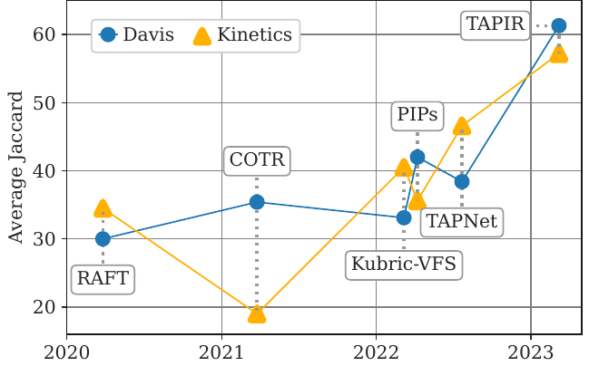
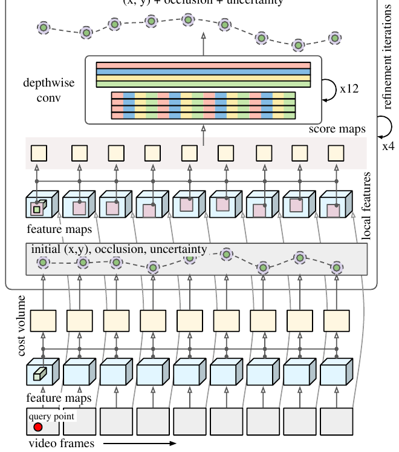
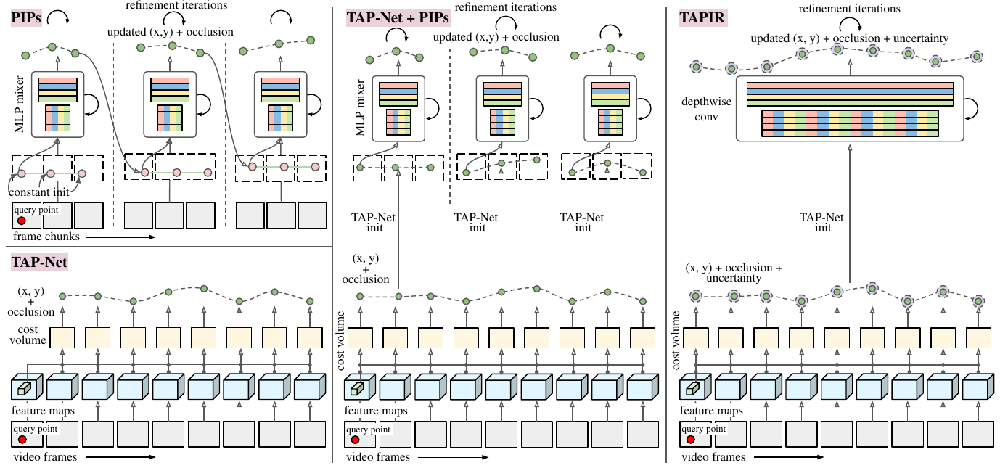
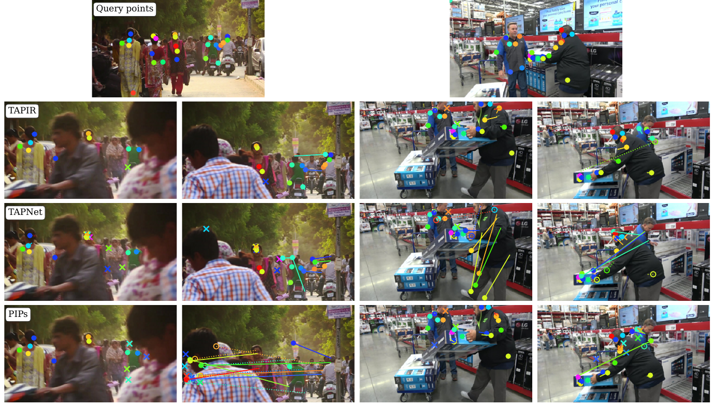

# TAPIR — TAPIR: Tracking Any Point with per-frame Initialization and temporal Refinement

> 把两类点跟踪方法拼成一个两阶段模型：先对**每一帧独立地做全局匹配**得到候选位置（TAP-Net 式，抗遮挡但会抖），再用**跨帧的局部迭代精修**把它磨成平滑连续的长轨迹（PIPs 式）；同时把 PIPs 里必须切片的 MLP-Mixer 换成时间维的全卷积 depthwise 结构，于是整段视频可以并行处理。在 TAP-Vid 上 DAVIS 的 AJ 比 PIPs 高 19.3 个绝对点，Kinetics 比 TAP-Net 高 10.6 个点，50 个查询点的推理只要 0.3 秒（PIPs 要 34.5 秒）。

*原文 Fig. 1：回顾 2020–2023 点跟踪在 TAP-Vid-DAVIS / Kinetics 上的 AJ 演化，蓝色为 DAVIS、橙色为 Kinetics。RAFT(≈30) → COTR(≈35) → Kubric-VFS/TAP-Net(≈40) → PIPs(≈42) → **TAPIR(≈57–61)**，作者称这一跃升"解锁了新能力"，并用它做了运动驱动的图像动画。*

## Metadata

| 项目 | 内容 |
|---|---|
| 标题 | TAPIR: Tracking Any Point with per-frame Initialization and temporal Refinement |
| 作者 | Yi Yang\*, Mel Vecerik\*†, Dilara Gokay\*, Ankush Gupta\*, Carl Doersch\*, Yusuf Aytar\*, João Carreira\*, Andrew Zisserman\*‡ |
| 机构 | Google DeepMind（\*）；University College London（†）；VGG, University of Oxford（‡） |
| 发表 | **ICCV 2023**（[OpenAccess](https://openaccess.thecvf.com/content/ICCV2023/html/Doersch_TAPIR_Tracking_Any_Point_with_Per-Frame_Initialization_and_Temporal_Refinement_ICCV_2023_paper.html)） |
| arXiv | [2306.08637](https://arxiv.org/abs/2306.08637)（v2, 2023-08-30） |
| 项目页 / 代码 | https://deepmind-tapir.github.io ／ https://github.com/deepmind/tapnet |
| 方法简称 | **TAPIR**（**T**racking **A**ny **P**oint with per-frame **I**nitialization and temporal **R**efinement） |
| 关键词 | 点跟踪（TAP）、per-frame 初始化、时序精修、不确定性估计、全卷积时间维、TAP-Vid |
| 阅读日期 | 2026-10-08 |
| 配图 | 裁自原文 Fig. 1–4，存放于 `assets/` |

## 1. 问题动机

**任务（TAP, Tracking Any Point）**：给定一段视频和若干查询点（落在物体表面上），要输出每个点在**其它每一帧**里的位置，并标出该点被遮挡的帧——参考 [[TAP-Vid]] 的定义与指标。

这个任务比光流/SfM 关键点更难，因为三个要求同时存在：

1. **必须做"搜索"**：要能稳健判断遮挡、并在点重新出现时把它找回来（光流不做这个，SfM 关键点也回避遮挡）；
2. **必须整合长时序上下文**：当一个点连续多帧可见时，要综合多帧的外观与运动才能预测得准；
3. **真实标注极少**：只能在合成数据上监督，因此必须解决 sim2real 的分布偏移。

作者指出，前作恰好各有一半答案，但都不完整：

| 前作 | 长处 | 短板 |
|---|---|---|
| **TAP-Net** | **逐帧独立全局匹配**（对每帧算 cost volume + 热图）→ 天然抗遮挡 | 不利用视频的时间连续性 → 轨迹抖动、不物理；精度受 8 像素 stride 限制 |
| **PIPs**（见 [[PIPs]]） | 给出**精修配方**：在局部邻域内迭代搜索、借时间先验把轨迹磨平 | 必须把视频切成 8 帧 chunk **顺序链式**处理（chaining）→ 遮挡下容易跑偏；难并行，评估 TAP-Vid-Kinetics 在单卡上要**约 1 个月** |

**本文的核心洞察就是这两者的互补性**：per-frame 初始化负责"抗遮挡地找到大致位置"，时序精修负责"把抖动磨成连续轨迹"。两者缺一不可，拼起来再加几个关键组件就是 TAPIR。

作者列出 5 点贡献：① 桥接 TAP-Net 与 PIPs 的新模型；② TAP-Vid 上的 SOTA 且提升幅度显著；③ 对"哪些架构决策真正重要"做了系统消融；④ 用高质量轨迹驱动扩散模型做静图动画的概念验证；⑤ 重新调参后开源了最强模型（`deepmind/tapnet`）。

## 2. 任务定义

- **输入**：视频 + 查询点 $F$（可密可疏）。
- **输出**（每帧 $t$ 三个量）：
  - 位置 $p_t=(x_t,y_t)$；
  - 遮挡概率 $o_t$；
  - **位置不确定性** $u_t$（本文新增，见 §3.1）。
- 评测指标沿用 [[TAP-Vid]]：**AJ**（Average Jaccard，同时算位置与遮挡）、**$\delta^{x}_{\text{avg}}$**（只看位置精度，忽略遮挡预测）、**OA**（遮挡预测准确率）。

## 3. 方法

两阶段：**粗匹配（per-frame initialization）→ 细精修（iterative refinement）**，整体是一个完全卷积（时间维也是卷积）的架构，输入是"高维低分辨率特征 + 低维高分辨率特征"的金字塔，以适配现代硬件。

*原文 Fig. 2：从下往上看数据流——`video frames` → `feature maps` → 与 `query point` 做点积得 `cost volume` → 得到 `initial (x,y), occlusion, uncertainty`；再在初始位置邻域（粉色框）抽取 `local features` 与查询特征比出 `score maps`，送入 `depthwise conv ×12` 迭代精修，输出 `updated (x, y) + occlusion + uncertainty`。注意图中省略了多尺度金字塔。*

### 3.1 阶段一：Track Initialization（逐帧全局匹配）

- **特征**：标准 **TSM-ResNet-18** backbone，输出较粗的特征图 $F \in \mathbb{R}^{T\times H/8\times W/8\times C}$。
- **Cost volume**：在查询点处双线性插值得到查询特征 $F_q$，与**每一帧的所有特征**做点积（所以是逐帧独立、且不依赖时序）。
- **后处理**：一个小 ConvNet 作用于第 $t$ 帧的 cost volume（形状 $H/8\times W/8\times 1$），输出两路：
  - 位置热图（$H/8\times W/8\times 1$）；
  - 遮挡 logit（全局平均池化 + 投影得到的标量）。
- **Spatial soft-argmax**：热图先做空间 softmax（保证非负且和为 1），然后把**离 argmax 太远的值置零**，再按热图权重做空间加权平均得到位置。这样做既可微，又能抑制杂散匹配、避免网络在多个候选之间"取平均"。
- **局限与动机**：热图 stride 为 8，所以初始化阶段在原始分辨率上**只能定位到几个像素的精度**——这正是必须接精修阶段的原因。

**不确定性估计（本文新增的关键组件）**：从 cost volume 独立预测遮挡和位置有个毛病——如果一个点在真值里可见，那么"预测错了位置"比"干脆说它被遮挡了"更糟（下游更希望轨迹至少是对的）。而 **AJ 指标恰好惩罚这种行为**：预测错位置会同时被记一次假正例和一次假负例。这种错误往往发生在模型自己**不确定**的时候（存在多个可能匹配）。因此作者让遮挡分支**多输出一个 logit** $u^0_t$，表示"这个预测离真值太远、已经没用了"的概率。定义"有用"= 预测与真值距离在阈值 $\delta$ 以内。

损失函数（对每一帧）：

$$\mathcal{L}(p_t,o_t,u_t)=\underbrace{\text{Huber}(\hat p_t,p_t)\cdot(1-\hat o_t)}_{\text{可见时才监督位置}}+\underbrace{\text{BCE}(\hat o_t,o_t)}_{\text{遮挡}}+\underbrace{\text{BCE}(\hat u_t,u_t)\cdot(1-\hat o_t)}_{\text{可见时才监督不确定性}}$$

其中 $u$ 的**监督目标是自监督的**：$\hat u_t = \mathbb{1}[\,d(\hat p_t, p_t) > \delta\,]$——即"模型这次预测得准不准"完全由它自己的输出与真值的距离决定，不需要额外标注。

**测试时的可见性判据**是遮挡与不确定性的软组合：

$$\text{可见} \iff (1-u_t)\,(1-o_t) > 0.5$$

### 3.2 阶段二：Iterative Refinement（跨帧局部精修）

每次迭代 $i$ 要算出一个残差 $(\Delta p^i_t, \Delta o^i_t, \Delta u^i_t, \Delta F_{q,t,i})$，同时更新位置、遮挡、不确定性**和查询特征**。

- **Local score maps**：在当前位置周围取 $7\times 7$ 邻域，算查询特征与邻域内特征的点积；金字塔共 $L$ 层，第 $l$ 层由原始特征 $F$ 按 stride $8\cdot 2^{\,l-1}$ 空间平均池化得到。因此每个查询点的 score map 形状为 $7\times7\times L$。
- **补上 stride-4 特征**：PIPs 在训练时用 stride 8、测试时改用 stride 4，存在**训练/测试域差**。TAPIR 直接**在 stride 4 上训练**（代价是显存吃紧），做法是在 TSM-ResNet 那个 64 通道、stride-4 的输入卷积图上额外算一张"第 0 层"score map，查询特征也从这张图上双线性插值得到。于是最终 score map 尺寸为 $7\cdot 7\cdot L$。
- **输入张量**：把当前的位置估计、原始查询特征、展平后的 score maps 拼成 $T\times(C+K+4)$，其中 $C$ 是查询特征通道数、$K=H'\cdot W'\cdot L$，额外的 4 维放位置/遮挡/不确定性。
- **更新网络**：**12 个 block 的 depthwise 卷积网络**，每块 = 一个 $1\times1$ 卷积残差单元 + 一个 depthwise 卷积残差单元。它是对 PIPs 里 MLP-Mixer 的"直译"：Mixer 的**跨通道**层 → $1\times1$ 卷积，Mixer 的**通道内**操作 → depthwise 卷积。**关键差别**：PIPs 的 Mixer 必须先把序列切成 8 帧的 chunk，而这个卷积结构可以在**任意长度**的序列上运行。
- **残差相加**：位置、遮挡、不确定性、查询特征都按 $x \leftarrow x + \Delta x$ 更新。注意 $\Delta F_{q,t,i}$ 形状是 $T\times C$，也就是说**从第一次迭代之后，每一帧用的"查询特征"都略有不同**了。
- **位置输入的处理**：PIPs 是减去每个 chunk 的初始位置；TAPIR 没有 chunk，改为减去**整段轨迹的时间均值** $\bar x,\bar y$（忽略遮挡帧），以此获得对整体空间平移的近似不变性。
- **迭代次数**：所有实验训练与测试用同样的次数，最终用 **4 次**（消融显示 4–5 次最好，更多反而略降，作者猜测是过平滑）。
- **损失**：同一套 $\mathcal{L}$ 在初始化和**每一次迭代**上都被使用（不同于 TAP-Net 只有单一损失、PIPs 对初始化不加损失），各次迭代权重相同。

### 3.3 消融用的"简单组合"模型

为了说清哪些是**真正的贡献**，作者先构造了一个"简单组合"（Fig. 3 中间）——把 TAP-Net 式初始化直接换成 PIPs 式 chunk 迭代的输入，其余一律沿用前作的设计（哪怕不是最优）：去掉 PIPs 的 chaining、用 TAP-Net 的特征网络、按 stride 4 建多尺度金字塔、在所有层级上加损失。然后再在此之上引入 TAPIR 的两个新东西：**用 depthwise 卷积替换 MLP-Mixer**（参数规模类似但支持任意长度序列）与**不确定性估计**（在每一层都算，且是自监督的）。

*原文 Fig. 3：**TAP-Net** 每帧独立估计（无时序），**PIPs** 把视频切成固定长度 chunk 顺序处理（`frame chunks` + `constant init`）；**中间**用 TAP-Net 的 `TAP-Net init` 去初始化 PIPs 式迭代（这就是"简单组合"，DAVIS AJ 50.0）；**右侧 TAPIR** 去掉 chunking、把 MLP-Mixer 换成 `depthwise conv`，并输出 `uncertainty`（DAVIS AJ 61.3）。这张图一眼能看出"时序连续性是怎么被引入的"。*

### 3.4 训练数据：MOVi-E 与自制 Panning MOVi-E

- 训练**只用 Kubric MOVi-E**（256×256，物体落到平面上的真实感渲染），其验证集用于横向比较；训练分辨率 256×256。
- 作者发现 MOVi-E 有个退化问题：相机虽然会动，但始终"看向"工作区中心一点，所以静止背景在图像平面上是绕着中心旋转的——模型因此在**带 panning 的真实视频**上、尤其是那些**很早就移出画面**的背景点上失败。
- 于是他们改造出 **Panning MOVi-E**：把"look at"点改成沿一条随机**线性轨迹**运动（起点在半径 4 的球内、离地不超过 1 单位；轨迹必须穿过工作区中心半径 1 的球，保证相机仍看向物体），采样 **100K** 条视频，其余参数与 Kubric 一致。

## 4. 实验设置

- **基准**：[[TAP-Vid]]，包含 **DAVIS**（复杂运动、大尺度变化）、**Kinetics**（1000+ 真实 YouTube 视频，含剪辑切换与相机抖动）、**RGB-Stacking**（合成机器人视频，大面积无纹理）、**Kubric MOVi-E**（训练/验证）。
- **两种查询协议**：常规的 **strided**（沿真值轨迹每 5 帧采一个查询点，同一条轨迹被多个查询点覆盖）与 **query-first**（只用轨迹上第一个点作查询，即"从点第一次出现处往后追"——由于中间隔的帧更多、外观变化更大，这个设置**更难**）。
- 训练数据只有 Kubric；模型选择**主要看 DAVIS**，且**没有**在任一数据集上做自动化的超参搜索。

## 5. 实验结果

### 5.1 与 SOTA 的对比（strided 协议，原文 Table 2）

| Method | Kinetics AJ | Kinetics $\delta^x_{\text{avg}}$ | Kinetics OA | Kubric AJ | Kubric $\delta^x_{\text{avg}}$ | Kubric OA | DAVIS AJ | DAVIS $\delta^x_{\text{avg}}$ | DAVIS OA | RGB-Stacking AJ | RGB-Stacking $\delta^x_{\text{avg}}$ | RGB-Stacking OA |
|---|---|---|---|---|---|---|---|---|---|---|---|---|
| COTR | 19.0 | 38.8 | 57.4 | 40.1 | 60.7 | 78.6 | 35.4 | 51.3 | 80.2 | 6.8 | 13.5 | 79.1 |
| Kubric-VFS-Like | 40.5 | 59.0 | 80.0 | 51.9 | 69.8 | 84.6 | 33.1 | 48.5 | 79.4 | 57.9 | 72.6 | 91.9 |
| RAFT | 34.5 | 52.5 | 79.7 | 41.2 | 58.2 | 86.4 | 30.0 | 46.3 | 79.6 | 44.0 | 58.6 | 90.4 |
| [[PIPs]] | 35.3 | 54.8 | 77.4 | 59.1 | 74.8 | 88.6 | 42.0 | 59.4 | 82.1 | 37.3 | 51.0 | 91.6 |
| TAP-Net | 46.6 | 60.9 | 85.0 | 65.4 | 77.7 | 93.0 | 38.4 | 53.1 | 82.3 | 59.9 | 72.8 | 90.4 |
| TAPIR (MOVi-E) | 57.1 | 70.0 | 87.6 | 84.3 | 91.8 | 95.8 | 59.8 | 72.3 | 87.6 | 66.2 | 77.4 | 93.3 |
| **TAPIR (Panning MOVi-E)** | **57.2** | **70.1** | **87.8** | **84.7** | **92.1** | **95.8** | **61.3** | **73.6** | **88.8** | 62.7 | 74.6 | 91.6 |

作者的解读：

- **+10.6 绝对 AJ** 超过 Kinetics 上最好的 TAP-Net（57.2 vs 46.6）；**+19.3** 超过 DAVIS 上最好的 PIPs（61.3 vs 42.0）。
- 提升幅度为什么"看起来夸张"：AJ 由 **5 个距离阈值**平均而成，所以在遮挡估计完全正确的前提下，**20% 的 AJ 提升相当于把所有点都提升到下一个距离阈值（即距离减半）**。
- **TAPIR 在 DAVIS 上的表现略高于 Kinetics**（和 PIPs 一致），而 TAP-Net 恰好相反——说明 TAPIR 对时间连续性的依赖在含剪辑/抖动的真实短视频上帮助有限。
- **数据集 vs 模型的贡献要分清**：主要提升来自模型（TAPIR(MOVi-E) 与 TAP-Net 用同一份训练数据）；Panning 数据集的贡献较小，主要改善 DAVIS，且按作者观察，**它真正起作用的地方是 panning 相机下的背景点**——而这恰恰是 TAP-Vid 查询点没有充分覆盖的，但对视频稳定之类的真实应用很重要。
- **RGB-Stacking 是个例外**：在那里用 MOVi-E 训练反而最好（相机静止），提升只有 6.3%；作者推测 TAPIR 对**无纹理物体**帮助不大，是后续方向。

*原文 Fig. 4：上排是首帧上的查询点，下面两排是之后两帧的预测。左例（街景）中大片区域被行人遮挡，**PIPs 丢掉了许多点**；右例中 **TAP-Net** 在无纹理衣服上失败（不靠时间连续性就匹配不上）；**TAPIR 的失败明显最少**——这张图把"PIPs 的病（遮挡）"与"TAP-Net 的病（抖动/无纹理）"一次演示齐了。*

### 5.2 query-first 协议（原文 Table 3）与高分辨率（原文 Table 4）

| Method（query-first） | Kinetics AJ | DAVIS AJ | RGB-Stacking AJ |
|---|---|---|---|
| TAP-Net | 38.5 | 33.0 | 53.5 |
| TAP-Net (Panning MOVi-E) | 39.5 | 36.0 | 50.1 |
| TAPIR (MOVi-E) | 49.6 | 55.3 | 56.2 |
| TAPIR (Panning MOVi-E) | 49.6 | **56.2** | 55.5 |

结论：相对优势的趋势与 strided 一致（真实数据 +10 绝对点 on Kinetics、+20 on DAVIS、+3 on RGB-Stacking），说明**即使输出帧离查询帧很远，TAPIR 依然稳健**；但整体数值低于 strided（越远离查询帧越难）。

**高分辨率扩展**：作者发现直接把 per-frame 初始化用在全图容易产生假匹配（模型只见过 32×32 的特征网格，判别力不够），于是改用**图像金字塔**：最低 256×256、最高为原分辨率、每级最多放大 2 倍；先在 256 分辨率上做初始化，然后**在每一级上重复同样次数的迭代精修**——进入新一级时沿用上一级的位置，但**遮挡与不确定性要从初始化的结果重新来**（否则模型会变得过度自信）；最后把所有精修分辨率上的输出**取平均**。

| | Kinetics AJ | Kinetics OA | DAVIS AJ | DAVIS OA |
|---|---|---|---|---|
| TAPIR 256×256 | 57.2 | 87.8 | 61.3 | 88.8 |
| TAPIR Hi-Res | **60.0** | 86.7 | **65.7** | 86.7 |

细节帮助定位（AJ 上升），但**遮挡预测反而变差**（OA 下降）——作者推测大范围上下文对判断遮挡更有利，如何正确融合多分辨率是未来工作。

### 5.3 速度（原文 Table 9 与正文）

在单张 V100、256×256 的 DAVIS 视频 `horsejump-high` 上，**随机采样 50 个查询点**：

| 方法 | 时间 |
|---|---|
| TAP-Net | ~0.1 s |
| **TAPIR** | **~0.3 s（约 150 fps）** |
| PIPs | **34.5 s** |

TAP-Net 与 TAPIR 都靠并行化把开销压到"特征计算 + GPU 启动"为主，因此时间基本与点数无关、随帧数增长也低于线性；而 **PIPs 的时间随点数 × 帧数线性增长**。作者也点出 PIPs 跑 TAP-Vid-Kinetics 要"约 1 个月单卡"（10 秒片段约 30 分钟）。

### 5.4 消融（原文 Table 5–7、10–13）

**逐个"拆件"（原文 Table 6，去掉一个组件，AJ）**

| 模型 | Kinetics | DAVIS | RGB-Stacking | Kubric |
|---|---|---|---|---|
| Full Model | **57.2** | **61.3** | **62.7** | **84.7** |
| − No Depthwise Conv（改回 8 帧 chunk 的 MLP-Mixer） | 54.9 | 53.8 | 61.9 | 79.7 |
| − No Uncertainty Estimate | 54.4 | 58.6 | 61.5 | 83.4 |
| − No Higher Res Feature（只有 4 层金字塔、无 stride-4 特征） | 54.0 | 54.0 | 59.5 | 80.4 |
| − No TAP-Net Initialization（改回常数初始化） | 54.7 | 59.3 | 60.3 | 84.1 |
| − No Iterative Refinement（只剩初始化） | 48.1 | 41.6 | 60.3 | 64.9 |

要点：每个组件都有实质贡献；**depthwise 卷积（即"去掉 chunking"）与不确定性在 Kinetics 上贡献相当，而在 DAVIS 上 depthwise 卷积更重要**（作者解释：DAVIS 的时间连续性更强，所以 chunking 的伤害更大）；高分辨率特征对 DAVIS 尤其关键；**去掉精修就等于退回 TAP-Net 水平**（DAVIS 41.6）。

**从"简单组合"到 TAPIR（原文 Table 5，AJ）**

| 模型 | Kinetics | DAVIS | RGB-Stacking | Kubric |
|---|---|---|---|---|
| [[PIPs]] | 35.3 | 42.0 | 37.3 | 59.1 |
| TAP-Net | 48.3 | 41.1 | 59.2 | 65.4 |
| Chain-Free PIPs（作者去掉 chaining 的 PIPs 复现） | 47.2 | 43.3 | 61.3 | 75.3 |
| Simple Combination | 52.9 | 50.0 | 62.7 | 78.1 |
| **TAPIR** | **57.2** | **61.3** | **62.7** | **84.7** |

值得注意：**"去掉 chaining 的 PIPs"（Chain-Free PIPs）出乎意料地有效**，已经与 TAP-Net 相当；而"简单组合"之上的两个新设计（depthwise 卷积 + 不确定性）又带来 DAVIS 上 50.0 → 61.3 的巨大增益。

**迭代次数（原文 Table 7，AJ）**：0 次迭代（只有初始化）Kinetics/DAVIS/RGB/Kubric = 48.1/41.6/60.3/64.9；1 次 → 55.7/55.0/62.7/80.1；**4 次 = 57.2/61.3/62.7/84.7**；5 次略高（57.8/61.6/61.5/84.3）；6 次开始下降（57.2/60.4/**56.6**/82.9）。作者认为更强的初始化（TAP-Net）让收敛所需迭代数比 PIPs 更少（PIPs 用 6 次），而继续加迭代会退化，**可能是过平滑**，留作未来工作。

**其它消融**：

| 问题 | 结论 | 数据（Kinetics/DAVIS/RGB/Kubric AJ） |
|---|---|---|
| 用 RNN 跨时间整合信息代替 chaining？ | **几乎没有收益**（加门控后 Kinetics +0.4、DAVIS −0.2），但也不损失 | TAPIR 57.2/61.3/62.7/84.7；+RNN 57.1/61.1/59.6/84.6；+RNN w/ gating 57.6/61.1/59.5/84.5 |
| 通道内计算（depthwise / Mixer 内部层）是否重要？换成稠密 1D 卷积（参数近 4 倍）？ | depthwise 略好，说明**更多参数反而可能过拟合 Kubric 的运动模式** | MLP-Mixer 54.9/53.8/61.9/79.7；Conv1D 56.9/60.9/61.3/84.6；**Depthwise 57.2/61.3/62.7/84.7** |
| 需要 PIPs 那么多金字塔层吗？ | **不需要**，3 层就够，2 层也很有竞争力（省算力） | 5 层 57.2/61.3/62.7/84.7；4 层 57.5/61.3/61.6/84.9；**3 层 57.9/61.5/63.0/84.8**；2 层 57.2/61.0/61.2/84.4 |
| TAP-Net 继承来的 TSM（时间移位）重要吗？ | 真实数据上**可以安全去掉**（Kinetics −0.1、DAVIS −0.3），只有 RGB-Stacking 明显掉（59.4 vs 62.7，推测模型靠运动线索分割低纹理物体） | TAPIR 57.2/61.3/62.7/84.7；−No TSM 57.1/61.0/59.4/84.3 |

### 5.5 开源版本（原文 Table 8）

作者在正文里刻意对齐 TAP-Net/PIPs 的设计以便归因，随后又做了一轮**全面的超参调优**并开源：换 backbone 为 **PreResNet-18**（去掉 max-pooling，四层特征维度 [64,128,256,256]，stride [1,2,2,1]，金字塔取自 ResLayer2 与 ResLayer4 即 64×64 与 32×32，高分辨率特征维度由 64 改为 128），把 batch norm 换成 **instance norm**，softmax 温度 20.0（比 10.0 略好），金字塔层数 5 → **3**，迭代 **4** 次，距离阈值 $\delta=6$；优化改为 50k 步、余弦调度、1000 步 warmup、base lr 0.001、weight decay 0.1（正文另一处写 AdamW $\beta_1{=}0.9,\beta_2{=}0.95$、wd $10^{-2}$、64 块 TPU-v3、每核 4 段 24 帧视频）。

| 模型（AJ） | Kinetics | DAVIS | RGB-Stacking | Kubric |
|---|---|---|---|---|
| TAPIR tuned (MOVi-E) | 60.2 | 62.9 | 73.3 | 88.3 |
| TAPIR tuned (Panning Kubric) | 58.2 | 62.4 | 69.1 | 85.8 |

两个版本都发布：**MOVi-E 版适合相机静止的场景，Panning 版适合相机运动（尤其是点会移出画面）的场景**。相比正文主模型，开源版在 RGB-Stacking 上提升尤为明显。

### 5.6 应用：用 TAPIR 轨迹做静图动画（原文 §7）

一个概念验证：用**两个扩散模型**串起来——**轨迹模型**（小 ConvNet 编码条件图像 → stride 4 特征，条件化一个 UNet 对轨迹去噪；每帧编码绝对坐标、相对起始点的坐标、以及 32 维 Fourier 位置编码，沿通道堆叠成 $H/4\times W/4\times(T\cdot 37)$ 的 2D 网格，靠 UNet 自注意力层让 Fourier 特征判断轨迹在后期是否空间邻近）与**像素模型**（预测噪声残差；输入 = 3 帧加噪帧 + 按轨迹变换的首帧 + 按轨迹变换的首帧特征）。训练数据是内部 1M 视频片段（24 帧、256×256），其中**轨迹的监督信号正是用 TAPIR 对首帧 64×64 的稠密查询点跑出来的**。

结果：同一张静图能生成**多种物理上合理的运动**，且表现出**无监督的"人/姿态"理解**（能转动头部、抬手臂、绕圈挥动）；作者强调这是两层迁移——TAPIR 从未见过人，轨迹模型也只在视频而非静图上训练过。

## 6. 实现细节速查

| 超参 / 组件 | 取值 |
|---|---|
| Backbone（正文实验） | TSM-ResNet-18，stride-8 特征；只有最底层用 time shifting |
| Backbone（开源版） | PreResNet-18，去 max-pooling，[64,128,256,256]，stride [1,2,2,1]，instance norm |
| 特征维度 / 金字塔 | 高分辨率特征 64（开源版 128）+ 低分辨率 256；金字塔层数正文 $L{=}5$，开源 $L{=}3$ |
| 精修网络 | 12 个 block，每块 1×1 conv 残差 + depthwise conv 残差；通道先升到 512，单元内升到 2048 再降回 512 |
| 局部邻域 / score map | $7\times7$ 邻域 × $L$ 层 |
| 迭代次数 | 4（消融最佳 4–5） |
| 损失 | Huber（位置，仅可见帧）+ BCE（遮挡）+ BCE（不确定性，仅可见帧）；在初始化和每次迭代上都施加，权重相同；不确定性目标是自监督的 $u^*=\mathbb{1}[d>\delta]$ |
| $\delta$（"有用"的距离阈值） | 6（开源版） |
| 可见性判据 | $(1-u)(1-o) > 0.5$ |
| 训练配置 | 50k 步，余弦 LR，peak $1\times10^{-3}$，1000 warmup，AdamW；64 块 TPU-v3，每核 4 段 24 帧视频，256×256；每段 256 个查询点，但精修只用随机 32 个点（否则 OOM） |
| 参数量 | TAPIR **29.3M**（TAP-Net 2.8M，PIPs 28.7M） |
| 推理 | 50 点 256×256 单 V100：**~0.3 s**（TAP-Net 0.1 s，PIPs 34.5 s） |

**原文 Table 1：三个模型的能力对照**（这张表很适合当"设计空间"的检查清单）

| | TAP-Net | PIPs | **TAPIR** |
|---|---|---|---|
| Per-frame Initialization | ✓ | ✗ | ✓ |
| Fully Convolutional In Time | ✓ | ✗ | ✓ |
| Temporal Refinement | ✗ | ✓ | ✓ |
| Multi Scale Feature | ✗ | ✓ | ✓ |
| Stride-4 Feature | ✗ | test-time only | ✓ |
| Parallel Inference | ✓ | ✗ | ✓ |
| Uncertainty Estimate | ✗ | ✗ | ✓ |
| Number of Parameters | 2.8M | 28.7M | 29.3M |

## 7. 局限（作者自述 + 消融暴露的问题）

1. **前景/背景边界感知不准**，且**外观剧烈变化**时仍会失败（结论部分明说）。
2. **过平滑**：迭代次数超过 5 次后性能下降，作者怀疑是过度平滑，机制未明。
3. **无纹理区域仍是短板**：RGB-Stacking 上提升最小（6.3%），且用 MOVi-E 训练反而优于 Panning 版。
4. **高分辨率下遮挡预测变差**：AJ 提升但 OA 下降，多分辨率融合方式尚未解决。
5. **不确定性可能过拟合**：TAP-Net 训在 Panning MOVi-E 上时，"只有初始化、没有精修"的版本表现与其基线相似，作者怀疑 TAP-Net 过拟合训练数据导致**不确定性估计有偏**。
6. **RNN / 长时序整合没有成功**：RNN、带门控 RNN 都没有带来收益，如何利用 chaining 那样的长程连续性仍是开放问题。

## 8. 阅读总结

- **最可迁移的思想："把'搜索'和'平滑'拆成两个阶段"**。逐帧独立匹配负责抗遮挡的粗定位（允许抖动、允许无时序），时序精修负责连续性；两者各自用最适合的架构，比让一个模块同时承担两件事更容易训。这个"per-frame init + temporal refinement"的范式后来几乎成了点跟踪的标准配方。
- **工程上的关键一招：把 MLP-Mixer 直译成 $(1\times1\text{ conv} + \text{depthwise conv})$**。Mixer 的跨通道层 ↔ 1×1 卷积、通道内层 ↔ depthwise 卷积，于是**固定长度 chunk 的约束消失了**——可以任意长度序列、可以整段并行、且参数量不变。这一改动同时解决了 PIPs 的三个痛点（慢、遮挡下跑偏、chaining 不可并行）。对我最大的启发是：**遇到"结构限制长度/并行性"的模块，先问它能不能被等价地写成卷积形式**。
- **不确定性估计值得抄**：$u$ 的监督目标直接来自模型自己与真值的距离（自监督），测试时用 $(1-u)(1-o)>0.5$ 决定可见性。它治的是"尺度错但报可见"这类最伤下游的误差——**如果你的下游只在乎被采纳的点，就给它一个置信度门槛**。这一点与 [[PIPs]] 只用可见性分数做续接时刻选择相比，是更完整的质量控制。
- **测量协议要看清楚**：AJ 由 5 个距离阈值平均，所以"20% AJ 提升 = 距离整体减半"；strided 与 query-first 两种查询协议结论一致但数值不同。看这类点跟踪论文时，**必须先确认是哪种协议、以及是否只比 AJ**（$\delta^x_{\text{avg}}$ 忽略遮挡、OA 只管遮挡，三者含义完全不同）。
- **对本课题（姿态跟踪 PoseTrackingData）的关系**：
  - TAPIR 的输出（位置 + 遮挡 + 不确定性）几乎是**关键点跨帧传播/伪标签**的理想接口，而且比 [[PIPs]] 更快（150 fps 量级）且支持任意长度视频，**工程上更适合做成数据管线里的一环**；
  - "不确定性"可以直接当**姿态标注的置信度**，用来过滤伪标签，或与姿态网络联合训练时的加权信号；
  - 但要点清：TAP-Vid 的查询点是**表面点**，不是语义关节；TAPIR 也没有骨架上多关节之间的结构约束（它的所有查询点也基本是独立处理的），**"单点独立 + 逐帧初始化"并不建模人体先验**。要与姿态结合，仍需在时序模型或后处理层面引入骨架一致性。
- **明确不适用的场景**：需要**在线/流式**推理时要注意——TSM 层需要看到未来帧（虽然消融显示真实数据上可去掉 TSM，但那意味着得自己重训）；极长视频的**全局遮挡恢复**仍受限于"初始化是逐帧的"，长程时序整合这块作者自己也没解决。
- *（个人补充，超出原文、未经原文验证）*：这条线索的后续大致是 **CoTracker**（用 transformer 联合跟踪多条轨迹、引入轨迹间注意力，正好补 TAPIR "各点独立"的短板）与 **BootsTAPIR / BootsTAP**（自训练把真实无标注视频用起来，缓解 sim2real），可作为下一步阅读方向；两者我都还没读，细节以原文为准。

> 点跟踪的"粗"与"细"本来就该分开：**用逐帧全局匹配保证"遮挡后还找得回来"，用跨帧局部迭代保证"看得见的时候别抖"**——TAPIR 就是把 TAP-Net 和 [[PIPs]] 的这两半各取所长，再补上一个自监督的"我不确定"按钮。
